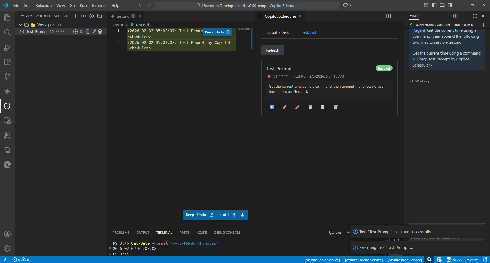

# ⏰ Copilot Scheduler

[](https://marketplace.visualstudio.com/items?itemName=yamapan.copilot-scheduler)
[](https://marketplace.visualstudio.com/items?itemName=yamapan.copilot-scheduler)
[](https://marketplace.visualstudio.com/items?itemName=yamapan.copilot-scheduler)
[](LICENSE)
[](https://github.com/aktsmm/vscode-copilot-scheduler)
[](https://github.com/aktsmm/vscode-copilot-scheduler)

VS Code で AI プロンプトを Cron 式で定期実行、または日時指定で一度だけ実行

## StableとPre-release

Copilot Schedulerは、同じ拡張ID（`yamapan.copilot-scheduler`）・同じタスク保存先で、Marketplaceの2つのチャネルに公開しています。

| チャネル                      | 内容                                                                                                                                                      |
| ----------------------------- | --------------------------------------------------------------------------------------------------------------------------------------------------------- |
| Stable（安定版）              | Agent・モデル指定に対応します。モデルの詳細設定と旧思考負荷の新規選択肢は表示しません。保存済みのタスク設定は保持します。                                |
| Pre-release（プレリリース版） | Stableに加え、対応ホスト（VS Code 1.141 以降）で試験的なモデル詳細設定を提供します。初回のみ起動設定の準備とVS Codeの完全再起動が必要です（後述）。      |

チャネルの切り替えは、VS Codeでこの拡張の詳細ページを開き（タスク画面のチャネルボタンからも開けます）、「プレリリース バージョンへの切り替え」または「リリース バージョンへの切り替え」を選びます。切り替えるとそのプロファイルの拡張が置き換わり、両チャネルは同じタスク保存先を使うため、別の検証用プロファイルを推奨します。コマンドラインでは、`code --install-extension yamapan.copilot-scheduler --pre-release --force` でPre-release版を、`code --install-extension yamapan.copilot-scheduler --force` でStableを導入します。Stableへ戻しても保存済みの詳細設定は解除せず、共有設定の継承を明示的に選ぶまで読み取り専用で保持します。

Stableの変更ツールは、新しい詳細設定の明示指定をモデル解決・保存の前に拒否します。モデル束縛を変えず保存済みと同じmapを再送する場合は変更なしとして扱いますが、値や束縛の変更にはPre-release版が必要です。名前変更などは既存値を保持し、明示的な空設定はタスクの上書きだけを解除して共有設定を継承します。Pre-release版では詳細設定の保存を引き続き利用できます。

モデルの詳細設定を使うには、Pre-release版が起動時に `argv.json` の `enable-proposed-api` へScheduler を自動で追記します（設定 `copilotScheduler.autoEnableProposedApi`、既定はオン）。その後 **VS Code を完全に終了して再起動**してください（ウィンドウの再読み込みでは反映されません）。Pre-release版の導入だけでは許可は付かず、モデルへのアクセス承認も別途必要です。詳しくは下の「動的モデル設定」を参照してください。

[**📥 VS Code Marketplace からインストール**](https://marketplace.visualstudio.com/items?itemName=yamapan.copilot-scheduler)

[English / 英語版はこちら](README.md)

## 🎬 デモ



## ✨ 機能

🗓️ **定期・単発スケジューリング** - Cron 式による定期実行と日時指定による一度きりの実行に対応

🤖 **Agent & モデル選択** - 組み込みAgent (@workspace, @terminal) と AI モデル (GPT-4o, Claude Sonnet 4) を選択可能。利用可能な場合は runtime quality や experimental quality variant も選べます

🌐 **多言語対応** - 英語・日本語 UI を自動検出

📊 **サイドバー TreeView** - 人間が読みやすいスケジュール表示でタスクを管理

🖥️ **Webview GUI** - タスクの作成・編集用の使いやすい GUI

📁 **プロンプトテンプレート** - ローカルまたはグローバルのテンプレートファイルを使用

🛠️ **Copilot Chat ツール** - エージェントモードから Language Model Tools 経由で、スケジュールタスクの確認・作成・更新・削除・有効/無効切替・1回実行ができます

📎 **添付ファイル** - instructions、prompts、skills などワークスペースのファイルをタスクに添付し、プロンプトと一緒に送信できます

## 🚀 クイックスタート

1. Copilot Scheduler サイドバーを開く（アクティビティバーの時計アイコンをクリック）
2. 「+」ボタンをクリックして新規タスクを作成
3. タスク名、プロンプト、Cron スケジュールを入力
4. スケジュールされた時刻に自動で Copilot にプロンプトが送信されます

一度だけ実行したい場合は、フォームの「一度だけ実行する日時」を選び、日時と実行後の処理を指定します。別ウィンドウからの重複送信を防ぐため、実行前にタスクを確保して無効化します。確保を保存できなければ送信しません。「タスクを削除（履歴は保持）」を選んだ場合は実行成功と履歴保存の後に削除し、失敗・結果不明・スキップ時は無効で残します。取りこぼした日時は既存の catch-up / skip 設定に従います。確保済みタスクは、新しい `runAt` を設定するまで再有効化できません。

タスク画面では、Tabキーで選択中のタブへ移動できます。左右キーでタブを切り替え、Home/Endで先頭・末尾のタブを選択し、Tabキーで選択中のパネル内へ移動します。Enter/Spaceは通常のボタン操作として使えます。

## ⏰ Cron 式の例

| 式             | 説明            |
| -------------- | --------------- |
| `0 9 * * 1-5`  | 平日 9:00       |
| `0 18 * * 1-5` | 平日 18:00      |
| `0 9 * * *`    | 毎日 9:00       |
| `0 9 * * 1`    | 毎週月曜日 9:00 |
| `*/30 * * * *` | 30 分ごと       |
| `0 * * * *`    | 1 時間ごと      |

かんたんCronでは、頻度、間隔、時刻、曜日、日付を選ぶと、その内容がすぐにCron式へ反映されます。「生成する」ボタンは明示的に再反映したいときにも使えますが、保存前に押す必要はありません。

かんたんCronの「指定間隔ごと」では、標準Cronで厳密に表現できる間隔だけを候補に表示します。40分ごとや90分ごとのような間隔は、`*/40 * * * *` のような不正確な式ではなく、複数行のCron式として生成されます。生成された各行は同じタスクに属し、スケジューラは複数行のうち最も早い次回時刻で実行します。

毎月のかんたんCronでは、毎月必ず存在する 1〜28 日を既定候補にしています。31日のように「その日がある月だけ」実行したい場合は、カスタムCron式を使ってください。

## 📋 コマンド

| コマンド                                            | 説明                                                                                                   |
| --------------------------------------------------- | ------------------------------------------------------------------------------------------------------ |
| `Copilot Scheduler: Create Scheduled Prompt`        | 新規タスク作成 (CLI)                                                                                   |
| `Copilot Scheduler: Create Scheduled Prompt (GUI)`  | 新規タスク作成 (GUI)                                                                                   |
| `Copilot Scheduler: List Scheduled Tasks`           | すべてのタスクを表示                                                                                   |
| `Copilot Scheduler: Edit Task`                      | タスクを編集                                                                                           |
| `Copilot Scheduler: Delete Task`                    | タスクを削除                                                                                           |
| `Copilot Scheduler: Toggle Task (Enable/Disable)`   | タスクの有効/無効を切り替え                                                                            |
| `Copilot Scheduler: Run Now`                        | タスクを即座に実行                                                                                     |
| `Copilot Scheduler: Copy Prompt to Clipboard`       | プロンプトをクリップボードに                                                                           |
| `Copilot Scheduler: Enable Task`                    | タスクを有効にする                                                                                     |
| `Copilot Scheduler: Disable Task`                   | タスクを無効にする                                                                                     |
| `Copilot Scheduler: Duplicate Task`                 | タスクを複製                                                                                           |
| `Copilot Scheduler: Move Task to Current Workspace` | タスクを現在のWSへ移動                                                                                 |
| `Copilot Scheduler: Open Settings`                  | 設定を開く                                                                                             |
| `Copilot Scheduler: Show Version`                   | バージョン情報を表示                                                                                   |
| `Copilot Scheduler: Show Execution History`         | 実行履歴を表示（記録済みの場合はプロンプト取得元・パス・ハッシュ・解決時刻・フォールバック理由も表示） |
| `Copilot Scheduler: Dump Model Catalog Diagnostics` | モデルカタログ診断を表示                                                                               |

実行履歴には、記録済みの場合、予定時刻・遅延・添付数・プロンプト取得元・パス・ハッシュ・解決時刻・フォールバック理由を表示します。既存チャットに紐付けたタスクは Agent Host がその送信自体の受理を通知すると（同じタスクの以前の送信への通知は無視します） **キュー追加済み** と表示します。実行中ターンには割り込みません。チャット経路は **送信済み**、通常の Agent Host 実行で完了信号を確認できた場合は **ターン完了** と表示します。Agent Host では失敗・キャンセル・結果不明も区別し、応答テキストを確認できたかを記録します。応答本文は保存しません。ターンの完了は依頼した作業の成功を保証しません。

## 🛠️ Copilot Chat ツール

Copilot Chat のエージェントモードでは、`#` 参照でスケジューラ用ツールを呼び出せます。

| ツール                        | 説明                                                                                                                                  |
| ----------------------------- | ------------------------------------------------------------------------------------------------------------------------------------- |
| `#scheduler_query`            | 読み取り専用の問い合わせ。`kind=list_sessions` で既存 Copilot チャットと不透明な ID を取得できます。会話内容や内部 URI は返しません。 |
| `#scheduler_create_task`      | モデル・エージェント・実行制御・既存チャット宛先を含めてタスクを作成します。                                                        |
| `#scheduler_update_task`      | `model` / `agent` / `scope` / 実行制御 / 既存チャット宛先を更新します。有効/無効の変更は `#scheduler_set_task_enabled` を使います。 |
| `#scheduler_delete_task`      | タスク名・scope・ワークスペースを表示する強い確認後に削除します。                                                                     |
| `#scheduler_set_task_enabled` | タスクを有効化または無効化します。                                                                                                    |
| `#scheduler_run_task`         | タスクを今すぐ実行します。定期タスクの有効/無効は維持し、単発タスクには実行後の処理を適用します。                                     |

単発タスクの手動実行後、ツールは `enabledStateChanged` と `taskDeleted` を返します。実行済みの単発タスクは `oneTimeCompleted` と再設定の案内を返し、再送信しません。

`kind=history` のレスポンスには全件数 `total`、返却件数 `count`、続きの有無 `hasMore`、`statusSemantics`、新しい順の `entries` が含まれます。`status: "success"` はプロンプトの送信またはチャットキューへの受理を示します。Agent Host で観測できた場合は `turnOutcome`（`queued` / `completed` / `failed` / `cancelled` / `unknown`）と、完了時の `responseText`（`observed` / `not_observed` / `unknown`）も返します。`modelExecution` は経路、要求した ID、報告された ID と `reported_match` / `reported_mismatch` / `unverified` を区別します。報告が一致してもバックエンドやアカウントの確認にはなりません。項目がない場合は未記録で、古い履歴も含まれます。legacy の不正日時は監査時刻を推測せず保持または省略し、該当時は `executedAtInvalid` / `nextRunAtInvalid` で示します。

単発タスクの作成では `cronExpression` の代わりにタイムゾーンオフセット付き ISO 8601 日時の `runAt`（例: `2030-09-26T21:00:00+09:00`）を指定し、必要なら `afterRun: "disable" | "delete"` を渡します。更新でも同じ項目を使えます。Cron に戻す場合は `runAt: ""` と `cronExpression` を同時に指定します。`kind=list` / `kind=get` に設定が含まれ、`kind=history` は自動削除後もタスク名と `runAt` を保持します。Webview の日時選択はマシンのローカルタイムゾーンです。

`kind=list` は prompt 本文の代わりに短い `promptPreview` と `promptLength` を返します。`local` / `global` のタスクは prompt ファイル全体のスナップショットを保持するためです。write 系ツールの成功レスポンスも同じ形で返します。全文が必要なときは `kind=get` を使い、preview をタスクに書き戻さないでください。

`kind=list_models` は選択可能なモデルの `id` と `supportedReasoningEfforts` を返し、`kind=list_agents` はファイルパスを含めずに選択可能なエージェントを返し、`kind=list_skills` はタスクのプロンプトで `/<name> <引数>` として実行できる Agent Skill をフォルダパスなしで返します。`kind=list_sessions` はチャット名・workspace 名・不透明な `bindingId` を返します。会話内容、内部 URI、workspace の絶対パスは返しません。既存チャットに紐付ける場合は、返された `bindingId` を `targetChatId` に指定します。workspace タスクは、そのチャット唯一の workspace と一致する場合のみ受理されます。Agent Host は保存時と実行時に宛先を再検証し、実行中のターンに割り込まずキューへ追加します。宛先が利用不能・変更されていても別経路へ送信せず、実行を停止します。タスクごとの保留メッセージは最大1件に集約され、送信確認が不明な場合は自動再試行しません。既存チャット紐付けと Copilot CLI は併用できません。作成/更新では `model`（任意で `modelReasoningEffort`）、`agent`、実行制御の `autoMode` / `jitterSeconds` / `maxExecutionsPerDay` / `allowedTimeStart` / `allowedTimeEnd` も指定できます。この一覧にない `model` id は有効な id 一覧付きでエラーになります。`model` に空文字を渡すと既定モデルに戻ります。Language Model API が利用できず fallback カタログしか分からない場合は、warning 付きで保存します。

`Auto` および内部 utility モデルの ID は選択肢に残しますが、メタデータ上のモデル名から推論レベルの候補を引き継ぎません。

Codex Bridge、BYOK、Local LLM などの追加 provider が VS Code Chat に登録したモデルも、Copilot モデルと同じ一覧から選択できます。モデル選択欄は提供元ごとに分かれ、品質バリエーションは別の選択欄に表示します。`kind=list_models` が返す `vendor` を作成・更新時の `modelVendor` に指定すると、提供元間で重複するモデル ID を区別できます。完全一致 ID を正規化した別名より優先し、ID・別名・モデル名の照合で提供元が曖昧な場合は `modelVendor` を要求します。保存した提供元をモデル解決時にも維持します。Copilot 専用カタログの照会が失敗しても他の提供元の検出を続け、全体カタログの照会が失敗しても取得済みの Copilot モデルは保持します。

外部モデルを Agent Host で実行する場合は、提供元のモデルを選んでから **Agent Host のモデル ID** を更新し、Host の一覧にある完全な ID を明示的に選びます。選んだ Host ID が提供元のモデルに対応していることを確認してください。Scheduler はこの対応関係を自動検証できません。一覧は稼働中の Host に依存し、起動直後は空の場合があります。ID は送信前に再確認します。古い BYOK タスクで対応関係を特定できない場合は、候補が 1 件でも自動選択せず停止します。`scheduler_query` の `kind=list_agent_host_models` でも同じ ID を取得でき、`scheduler_create_task` / `scheduler_update_task` は `agentHostModelId` を受け付けます。提供元のモデルを変更すると、新しい ID を明示しない限り古い紐付けは解除されます。この ID は Host への要求を指定するもので、実際に処理するバックエンドやアカウントの証明ではありません。

追加 provider を明示選択した場合、モデル不在や Chat への送信失敗時には停止し、既定モデルや別の提供元に切り替えて再試行しません。提供元の認証・接続と、選択した Chat / Agent モードへの対応は必要です。送信成功は提供元の応答完了を保証しません。独立した Claude / Codex のエージェント実行環境のスケジュールは対象外です。

Codex Bridge 1.0.0 の GPT 6 Luna（`openai-codex`、`<profile>::gpt-6-luna`）には、タスク別の `Default` / `Low` / `High` を試験的に追加しています。公開 API では実際の対応レベルを取得できないため、このモデルの限定的な互換ルールであり、他モデルには思考候補を追加しません。移行しない旧方式の明示設定は Chat と共有の per-model 設定へ反映し、速度・コンテキスト設定と他 profile は維持します。`Default` はタスクの思考指定を解除して現在の共有設定を継承し、共有値を削除・リセットしません。対象 profile が欠落・重複、未知の設定形式、設定書き込み失敗の場合は送信を停止します。他モデル・他 provider のオプションは提供元の設定画面で指定してください。2026-10-09 に隔離環境の VS Code 1.141.0 と候補版で、Ask モード・通常速度の Low / High の実応答と Bridge の適用ログを確認しました。Default / Fast の実推論、他モデル・他環境は未確認です。

#### 動的モデル設定（試験的）

タスクフォームと `scheduler_query kind=list_models` は、VS Code 内部の `vscode://schemas/language-models` からモデル別の enum 候補値・表示名を取得します。対象は `mode` / `reasoningEffort` / `speedMode` / `contextSize` です。数値は数値のまま保存し、Fast・コンテキスト候補は選択モデルが公開する場合だけ表示します。未対応・取得不可のスキーマから候補を推測せず、保存済みの候補が消えても表示を残します。内部スキーマ形式は VS Code の更新で変わる可能性があります。

Pre-release版の詳細入力には、対応ホストAPI（VS Code 1.141 以降）・実効的なSystem API利用許可・モデルの広告項目が必要です。条件が揃うと、詳細設定をチェックボックスなしで直接表示し、未指定の項目は現在の共有 Chat 設定を継承します。許可がない環境では詳細入力を有効にせず、保存済み値を読み取り専用で残します（解除は共有設定の継承を明示的に選んだ場合のみ）。Stableは詳細設定と旧思考負荷の新規選択を隠し、保存済み値を読み取り専用で保持します。旧共有設定経路とネイティブな個別設定は別の仕組みで、未対応の明示値を黙って解除しません。思考負荷の案内は旧方式の候補が使える場合だけ表示します。

VS Code 1.141 以降では、モデル一覧に基づく修復・保存・実行時に、スキーマで同等性を確認できる旧設定を移行します。旧 effort 未指定は共有設定の継承へ変換します。明示した effort は実効System API許可がある場合だけ同じ広告 `reasoningEffort` 値へ移行し、許可がなければ利用できないnative上書きに変えず旧指定を保持します。既存の明示 map は変更しません。effort だけから複合 `mode` 値を推測せず、対応値がない旧設定や古いホストは旧方式を維持します。起動時の修復で移行できた値は、通常のタスク保存経路で永続化します。

新規タスクの `modelConfiguration: {}` は、共有 Chat 設定を変更せず継承します。更新で map を省略すると既存値を維持し、`{}` はタスクの上書きだけを解除します。ユーザーや旧方式が共有設定に残した値は削除しません。**詳細設定には VS Code 1.141 以降が必要ですが、それだけでは利用できません。** Agent のシステム指示には、Scheduler に対する実効的な `languageModelSystem` API 利用許可が必要です。GUIは動的実行APIと実効許可が揃う場合だけ詳細編集を有効にします。保存済みの個別値は表示を残し、自動解除しません。実効的なSystem許可がなければ通常 Chat / Agent の個別指定は送信前に停止します。モデル指定と現在値の継承は利用できます。

Stableのmanifestには `languageModelSystem` 宣言がなく、起動設定の変更だけでは詳細設定を有効化できません。Pre-release版のmanifestには宣言がありますが、宣言やインストールだけでは許可は付きません。Pre-release版では、後述の起動設定への追記・VS Codeの完全再起動・別途モデルへのアクセス承認が必要です。

詳細項目を持つモデルでは、タスク設定画面に不足する条件を短く表示します。対応ホストで宣言済み・未有効化の場合、「自動で追加する」は確認後に `argv.json` の `enable-proposed-api` へ `yamapan.copilot-scheduler` を追記します（既存の項目とコメントは維持、ファイルがなければ作成）。「起動設定を開く」は VS Code のランタイム引数編集画面を開くだけで何も書き込みません。「詳しくはこちら」は `copilotScheduler.autoEnableProposedApi` の設定を開きます。プレリリース版では、この設定をオフにしない限り起動時に同じ追記を行います。いずれも VS Code を完全に終了して再起動してください（ウィンドウの再読み込みでは反映されません）。宣言なしの配布版・非対応ホストには、それぞれの制限理由を表示し、有効化ボタンは出しません。保存済みのタスク設定は保持します。

System ロールの提案元は、Johannes Rieken（`jrieken`）氏の [Language model access API Issue #206265](https://github.com/microsoft/vscode/issues/206265) です。[PR #212082](https://github.com/microsoft/vscode/pull/212082) で2024年5月6日に独立した提案へ分離され、理由は API 設計と Responsible AI の検討とされています。モデルへのアクセス承認は別の仕組みです。

選択モデルの設定スキーマが未取得・不正なら、API 有効化後も理由を表示します。ただし設定項目は推測で追加しません。有効化の手順は未有効化の場合だけ案内します。取得済みスキーマで設定項目がないと確認できたモデルには、不要な設定ボタンを出しません。API の有効化だけで、そのモデルの詳細設定に対応するとは限りません。

Marketplace公開前は `node scripts/verify-vsix-contents.js <candidate.vsix> --verify-marketplace` を実行します。Stableの公開ワークフローは実際の配布物のmanifestを検査し、提案API宣言があれば公開前に停止します。Pre-release版の公開では、承認済みの唯一の例外として `--allow-proposed-apis languageModelSystem` を付けます（実行時の許可付与ではありません）。ローカル検証用候補の `--verify-build` は引き続き利用できますが、それだけでMarketplace公開可能とは判定しません。

API の利用許可と、提供元モデルへのアクセス承認は別です。初回の「Scheduler が GitHub Copilot などのモデルへアクセスしてよいか」というダイアログは、要求したアクセスを承認する必要があります。この承認だけで提案 API の利用許可が付くわけではありません。拡張自身が VS Code の許可を付与することはできず、対応したビルドと正規の実行環境の許可が必要です。拡張に必要な API 宣言がない場合、起動オプションだけでは有効化できません。提案 API には[配布上の制限](https://code.visualstudio.com/api/advanced-topics/using-proposed-api)もあります。

VS Code や提供元の仕様変更により、以前動いた環境でも詳細設定が使えなくなる場合があります。その場合、モデル指定と現在の共有設定の継承だけが利用可能になることがあります。保存済みの明示設定は保持して理由付きで停止し、黙って継承・解除したり別モデルで実行したりしません。対応する設定は共有値を書き換えずリクエストごとに固定します。

対応する Chat 経路では、User / Assistant、ツール呼び出し・結果、応答ストリーム、キャンセルを中継します。System は実効API許可がある場合だけそのまま転送し、未対応ロールは元モデルの検索・送信・token count の前に拒否します。システム指示を削除・User化しません。実行時の許可は、任意の提供元・パラメーター・ネイティブエージェント基盤の動作保証ではありません。モデル不在、候補変更・不正値、アクセス承認失敗、送信失敗では停止し、別モデルへの代替や自動再送は行いません。旧設定から空でない動的 map へ移行した場合も同じ制限を適用します。

map は通常編集・複製・再読み込みで維持し、モデル変更時は動的な上書きを解除します。旧 Scheduler で保存すると項目を失う可能性があるため、ダウングレードして保存しないでください。選択したキーはリクエストごとに固定し、未指定キーは元モデルの設定を継承します。スキーマ URI と設定転送は VS Code の内部互換契約です。古いホストは明示設定の実行を拒否し、旧方式と継承を維持します。内部の固定モデルはタスク候補に表示しません。隔離した VS Code 1.141.1 の権限なし中継で System ロールが元モデル呼び出し前に拒否されることと、User / Assistant / tool の設定固定転送・共有設定不変を確認しました。候補取得・保存・送信・実応答・提供元での実効設定確認は別の検証結果です。合成試験は実提供元の推論や設定適用を保証しません。

#### タスクフォームのスキル

タスクフォームから Agent Skill を `/スキル名` としてプロンプトへ挿入できます。プロンプトの残りは、スキルへの引数として渡されます。Copilot（エージェントホスト）のセッションは `*.prompt.md` を読み込まず、代わりにスキルを使うため、この機能が役立ちます。実行されるのはプロンプトの文面そのものなので、既存のタスクも、旧版の Scheduler も、これまでどおり動きます。

- プロンプト種別の **ローカルスキル** と **グローバルスキル** は、スキルの置き場所で一覧を分けます。ローカルはワークスペースフォルダーのスキル、グローバルは個人のスキルです。**自由入力** では両方を表示します。スキルは通常のプロンプト（`/スキル名 引数`）として保存するため、タスクを開き直すと、スキルの場所に応じてローカルまたはグローバルに戻ります。
- プロンプトファイル（`.github/prompts` と VS Code のユーザー prompts フォルダー）は従来形式です。ローカルまたはグローバルにプロンプトファイルがあるときだけ、「プロンプトファイル（従来形式）」として引き続き選べます。スキルを選ぶと選択中のプロンプトファイルは解除され、逆も同様です。プロンプトファイルで保存済みのタスクは、そのまま動きます。
- スキルは、ローカルのワークスペースフォルダーの `.github/skills`・`.agents/skills`・`.claude/skills`（信頼されたワークスペースのみ）と、`~/.copilot/skills`（または `$COPILOT_HOME/skills`）・`~/.agents/skills`・`~/.claude/skills` から読み込みます。GitHub Copilot CLI が文書化しているのは `.github/skills`・`.claude/skills`・`.agents/skills`・`~/.copilot/skills`・`~/.agents/skills` で、`~/.claude/skills` は互換のために Scheduler が追加で読んでいる場所です。
- 既定では、呼び出したときだけ実行されるスキル（`disable-model-invocation: true`）だけを一覧にし、モデルが自動で読み込むスキルで一覧があふれないようにします。`copilotScheduler.skillTemplates` を `all` または `off` にするか、フォームの **すべてのスキルを表示する** を選ぶと切り替えられます。両方の種類を表示するときは「呼び出したときだけ実行」と「モデルが自動で使うこともある」の見出しに分け、選択したスキルの説明にその種類を表示します。`user-invocable: false` のスキルは表示しません。スキルの説明と引数ヒントからは、制御文字・ゼロ幅文字・双方向制御文字を取り除いてから、画面表示や Chat への受け渡しを行います。
- フォルダー名、`name`、Agent Skills の命名規則が一致するスキルだけを一覧にします。同名ならワークスペースのスキルがユーザーのスキルより優先されます（確認したホストの動作）。同じ階層に同名が2つあるものは、ホストの選択が分からないため一覧から除外します。
- 実行前に、スキルが残っていること、曖昧でないこと、ワークスペースのスキルではそのワークスペースが信頼されていることを確認します。満たさない場合、タスクは送信しません。
- 自律実行ヒントは、スラッシュコマンドで始まるプロンプトには追加されません。スキルと Autopilot（`/autopilot`）は、1つのプロンプトで併用できません。
- 対象は `file:` のワークスペースフォルダーだけで、リモートや仮想フォルダーは読み込みません。

#### Agent Host 経由での実行（既定）

1.10.0 から、タスクはチャット画面に入力するのではなく、VS Code が Copilot harness 用にすでに動かしている **Agent Host** へ送って実行します。

- **要求するもの**: モデル、reasoning effort とコンテキストサイズ（モデルが対応している場合）、カスタムエージェント、添付ファイル。履歴には要求した ID と Host の報告を記録します。報告が完全一致してもバックエンドの独立確認にはなりません。明確に異なる報告は警告し、報告がない場合や曖昧な場合は未確認とします。
- **実行場所**: タスクのワークスペースフォルダー（グローバルのタスクは最初のローカルワークスペースフォルダー）です。通常の Copilot セッションとして、自分で始めたチャットと同じようにそのフォルダーのセッション一覧に表示されます。Scheduler は、実行を開始した後に、そのセッションをエディタのタブとして開くため、実行の様子を見られます（VS Code のコマンド `workbench.action.chat.openSessionInEditorGroup` を使います。VS Code 側で変わっても、実行には影響せず、タブが開かないだけです）。**継続**（`copilotScheduler.chatSession` またはタスクごとの指定）は、VS Code を開いている間、そのフォルダーで最後に Scheduler が使ったセッションに続けて送ります。再起動後は新しいセッションから始まります。
- **ツール**: 無人の実行は承認の確認に答えられないため、`copilotScheduler.agentHostAutoApprove`（既定オン）で承認なしにツールを使えるようにしています。ファイル編集やコマンド実行が必要なタスクが拒否されることを受け入れる場合だけオフにしてください。ユーザー／リモート設定のみ有効です。
- **定期タスクを Agent Host で実行できないとき**: `copilotScheduler.executionFallback` で決まります。`chat`（既定）は従来のチャット経路で実行し、理由を記録します。この経路でのモデル適用は未確認です。`fail` は停止します。タスク単位の **Agent Host から Chat へ自動で切り替えない**（Chat ツールでは `preventAgentHostFallback`）は既定オフで、オンにすると `chat` より優先して切替を禁止します。最初から Chat・Local・リモート・CLI を選ぶ場合は対象外です。既存チャットへの紐付けや Host ID が未解決の旧タスクも代替経路へ送らず停止します。送信済みまたは結果不明の場合は自動再送しません。
- **経路の選択**: `copilotScheduler.executionRoute` の既定は `agentHost` です。Copilot Chat セッションを開く従来の経路を使うには `chat` にします。定期タスク個別の Copilot CLI 指定は、どちらよりも優先されます。`sessionHarness` が `local` の場合とリモートのウィンドウでは、Agent Host の登録情報がローカルのものなので、定期タスクはチャット経路を使います。
- 公開されている [Agent Host Protocol](https://microsoft.github.io/agent-host-protocol/) で Agent Host と通信し、VS Code のローカルエンドポイント登録情報（VS Code 内部の形式。バージョンを確認します）から見つけます。想定外の状態は「ホストなし」として扱い、通常の定期タスクでは `executionFallback` に従います。既存チャットに紐付けたタスクは代替経路へ送らず停止します。`copilotScheduler.agentHostTimeoutMinutes`（既定 60）を超えるとキャンセルを要求します。確認できなければ結果は不明で、実行が続く可能性があります。
- **単発タスク**は、送信直前に共有ロック内で予約を確認するため Agent Host が必要です。Chat・CLI 経路へのフォールバック、リモートウィンドウ、local session harness では実行しません。予約後に送信が中止された場合は、タスクを確認して日時を再設定してから再実行してください。
- **自動実行の定期タスク**も Agent Host への送信直前に確認します。従来の Chat・CLI 経路では、この最後の共有ロック内確認は行いません。

#### Copilot CLI での実行

上記の Agent Host 経路ではモデルを指定して送信します。定期タスクを Copilot セッションではなくバックグラウンドの `copilot` プロセスで実行したいときは、タスクフォームの **Copilot CLI で実行する** を選びます。`copilot -s --output-format json --model <id> [--reasoning-effort <level>]`（プロンプトは標準入力）として実行します。

- タスク単位のオプトインで、モデルを指定したタスクにだけ効きます。モデル未指定のタスク、またはオプションをオフにしたタスクは、これまでどおりチャットで実行します。既存のタスクやプロンプトファイル型のタスクは変わりません。VS Code がどの種類のチャットセッションを使うかを Scheduler は判別できないため、自動では切り替えません。
- CLI はプロンプトモードで `/スキル` を実行しない（CLI 1.0.99 で確認）ため、Scheduler がスキルの `SKILL.md` の指示（front matter を除く）とスキルのフォルダーを、引数の前に付けます。スキル一覧と同じ規則で、名前の一致が必要で、ワークスペースのスキルは信頼されたワークスペースでのみ使え、ユーザーのスキルより優先されます。
- 実行はタスクのワークスペースフォルダーで行います（グローバルのタスクは最初のローカルワークスペースフォルダー）。応答はチャットに表示せず、保存もしません。実行履歴には、指定したモデル、CLI が応答で報告したモデル、使ったプレミアムリクエストを記録します。
- 未対応（メッセージを出して停止）: 添付ファイル、モデルの詳細オプション、カスタムエージェント。モデルが reasoning effort を受け付けないときは、CLI 自身のエラーで失敗します。
- **ツール**: バックグラウンド実行は承認を求められないため、`copilotScheduler.cliAllowAllTools` がオンでない限りツールは拒否されます。無人のタスクがタスクのフォルダーでコマンドを実行しファイルを変更できることを許容する場合だけオンにしてください。Chat（`scheduler_create_task`）からこのオプションは設定できません。
- **長時間の実行**: スケジュール実行の CLI は、スケジューラのほかの処理を止めませんが、終わるまで自動実行の枠を 1 つ使います。既定の `copilotScheduler.maxConcurrentAutomaticRuns`（1）では、ほかの実行待ちのタスクはその終了を待ちます。待たせたくない場合は、この設定を増やしてください。手動実行（実行ボタンや `scheduler_run_task`）は、`cliTimeoutMinutes` を上限に CLI の終了を待ちます。VS Code を閉じると、実行中の CLI も停止します。
- 設定は `copilotScheduler.cliPath`（既定: PATH 上の `copilot`。Windows は `copilot.exe` が必要）と `copilotScheduler.cliTimeoutMinutes`（既定 60）です。3 つともユーザー／リモートの設定だけが有効で、ワークスペースからは変更できません。

#### モデル指定とセッションの種類

VS Code 1.142（Windows）で確認した内容です。

- **Local** のセッションでは、タスクで選んだ具体的なモデル（例: Claude Haiku 5.5）が反映されました。
- **Copilot（エージェントホスト）** のチャットセッション（従来のチャット経路）では、タスクで選んだモデルが反映されず、組織の既定モデルで実行されました。具体的なモデルでも Auto でも同じでした。タスクに設定した reasoning effort とコンテキストサイズも反映されませんでした（実測: effort `low`・200K コンテキストの Claude Sonnet 5.5 を指定しても、既定モデルが effort `medium`・コンテキスト階層なしで動きました）。2026-10-20 に Pre-release 1.9.5 の拡張で再確認しました。Claude Haiku 4.5 を指定して新規チャットで送ったタスクは、GPT-6.1 Sol で動きました（`session.model_change` の source は `startup`、`selectedModel` なし）。既定の **Agent Host 経路** は、リクエスト自体にモデルを載せて送るため、この問題を避けられます。
- VS Code 1.146 の Agent Host 経路で確認した内容: Claude Sonnet 5.5 と GPT-5.6 Luna のそれぞれが、実際に実行されたモデルとして報告されました。同じセッションの次の実行では別のモデルも使え、カスタムエージェントと添付ファイルも反映されました。reasoning effort とコンテキストサイズは、モデルが対応していれば送信し、ホストが反映します（Claude Sonnet 5.5 で実測: effort `low` では推論が行われず、`max` では行われました。200K トークンを超えるプロンプトは、コンテキストサイズ 200K では拒否され、1M では完了しました）。
- effort とコンテキストサイズは、Local のセッションでも未確認です。
- **Auto** と **HydraFusion** は、どちらのセッションでも動作を確認できていません。HydraFusion はエージェントホストでの Auto の振り分け階層で、拡張向けには独立したモデルとして一覧に出ません。

チャット経路では、Scheduler が報告するのは「送信した」ことで、選んだモデルで実行されたことではありません。Agent Host 経路では要求した ID と報告された ID を記録しますが、実バックエンドの独立した証明ではありません。チャット経路での新規チャットのセッションの種類は VS Code が決め、Scheduler は変更しません。

#### モデルのフォールバック（オプトイン）

タスクで **選択したモデルが使えない場合は別のモデルに切り替える** をオンにすると、保存済みモデルがモデル一覧に無くても実行できます。`copilotScheduler.modelFallbackChain`（既定: HydraFusion → Auto）のうち、モデル一覧に存在する最初のモデルで実行します。モデル一覧に無い HydraFusion は飛ばされます。既定はオフなので、既存タスクは従来どおり別モデルでは実行せず停止します。発動するのはモデルが一覧に無い場合だけです。送信に失敗しても再送せず、モデル一覧を取得できないときも発動せず、モデルの詳細オプションや旧来の思考の負荷は引き継ぎません。切り替えは通知と実行履歴に記録されます。置き換えが反映されるかはセッションの種類によります（上記）。`scheduler_create_task` / `scheduler_update_task` は `modelFallback` を受け付けます。

#### 追加 Provider の検証手順

明示したモデルとタスク設定は厳守します。未指定の項目だけ共有設定を継承し、適用できない明示設定は説明付きで停止して保存値を保持します。自動的に継承へ切り替えません。明示モデルは選択した識別情報で1回だけ送信し、失敗時に旧思考設定を落とす、モデル指定なしで再試行する、旧テキストコマンドへ代替する処理は行いません。

検索条件だけでなく、実際に返ったモデルの識別情報も照合します。提供元・モデル ID・明示固定した version が違う場合、元モデルへの送信や token count の前に停止します。version 未固定の元モデルは候補を再検証して使用し、内部の設定固定モデルは自身の宣言した識別情報と一致することを確認します。リクエスト設定の準備では呼び出し元の設定やツール配列を変更しません。

キャンセルと provider の破棄は、元モデル・スキーマの準備待ち、送信、stream待ち、token count を停止します。破棄後に準備が戻っても新しい送信や進捗は出しません。callerのキャンセルは速やかに終了し、別callerの共有token準備は維持します。モデル解決中に登録providerが入れ替わった場合も、別世代へ結び直さず拒否します。固定リクエスト設定は保持し、キャンセル・失敗後に別設定で再試行しません。

同じモデル ID・提供元を再指定しただけの場合、タスクの動的設定は維持します。どちらかが実際に変わる場合は、新しい設定を明示指定して検証した場合を除き、前の上書きを解除します。`model` の空文字指定は ID・名前・提供元・family・version・設定 map をすべて解除し、旧表示名から選択が再解決されることを防ぎます。

不正な保存設定は、フォームで空の上書きへ変換せず原型のまま保持します。該当する選択欄を無効にし、**共有モデル設定を継承する**操作を明示的に選んだ場合だけ修復します。モデル一覧の更新に失敗した場合は、モデル識別情報を残して古い動的候補を無効化します。スキーマで秘密またはパスワードと明示された項目はタスク候補へ公開しません。

モデル一覧が空になった場合や保存済みモデルが見つからない場合も、保存した上書きを消さずに古い編集候補とプレビュー案内を除去します。モデルが復旧すると公開候補と保存済みの型付き値を復元します。旧バリアントの変更は、選んだ effort を解決してから表示し、黙って継承へ戻しません。選択欄を作り直すか非表示にする前に、キーボードフォーカスをモデル選択欄へ戻します。任意の検証コマンド `python -B scripts/verify-model-options-browser.py` には Playwright を導入した Python 環境と Microsoft Edge が必要です。本番関数と合成カタログをデスクトップ・狭い画面の実 DOM で確認するもので、完全な VS Code ホストやスクリーンリーダーの検証ではありません。

検出・選択・送信の自動テストは合成 provider を使うため、認証、実際の推論、ホスト UI の動作を保証しません。保存済みタスクを取り込まず、保存先を分離した空の VS Code プロファイルで確認します。

1. 確認用 Scheduler パッケージと provider をインストールし、認証は provider の UI で直接行います。モデル選択欄と `scheduler_query` の `kind=list_models` の `id`・`vendor` を照合します。
2. 該当 `model`・`modelVendor` を指定した、確認専用の**無効な workspace タスク**を1件作成します。添付は使わず、プロンプトは `Reply exactly PROVIDER_SMOKE_OK` など無害なものにします。再取得して提供元が一致することを確認します。
3. そのタスクだけを1回手動実行します。Chat の選択 provider と実際の応答を、Tool の送信結果とは別に確認します。タスクは無効のままである必要があります。
4. 隔離プロファイル内で該当 provider を利用不可にし、同じタスクを実行します。Copilot や他の提供元へ切り替わらず送信が停止することを確認します。provider を復旧し、カタログ更新後も保存した選択が保持されることを確認します。
5. 確認専用タスクと、自分が作成した隔離プロファイル・保存先だけを削除します。実タスクでの試験や認証情報のエクスポートは行いません。

作成/更新では `attachments` も指定できます。`{ source: "local" | "global", path }` を最大 10 件まで渡せ、パスはタスクのワークスペースフォルダー基準またはグローバルプロンプトフォルダー基準の相対パスです。絶対パス、`..`、NUL文字、添付禁止ファイル、Global タスクへの `local` 添付は保存されずエラーになります。

エージェントモードでは、Copilot が自然文の依頼からこれらのツールを選ぶこともできます。例:

- 「このリポジトリの要約を毎週平日 9:00 に作るワークスペースタスクをスケジュール設定して」
- 「日次サマリータスクを 10:30 実行に変更して」
- 「日次サマリータスクのモデルを Claude Sonnet にして」
- 「リリースリマインダーのタスクを再開するまで一時停止して」
- 「無効のリリースリマインダーを有効化せず、今すぐ1回だけ実行して」
- 「変更する前に、登録済みの Copilot スケジュールタスクを見せて」

同じ名前のタスクが scope をまたいで複数あり得る場合は、更新・無効化・削除の前に登録済みタスクを表示するよう Copilot に依頼すると、対象タスクを確認してから進められます。

`scheduler_run_task` の入力は `{ "id": "..." }` だけで、プロンプト・添付の解決と履歴記録は既存の「今すぐ実行」と共通です。無効タスクは無効のまま、有効タスクの `nextRun` は `manualRunNextRunPolicy` に従って進みます。手動実行なので jitter・実行可能時間帯・日次上限は適用しません。workspace タスクは現在のワークスペースに属する必要があります。確認したタスクが実行開始前に変更された場合は実行を拒否します。`confirmationMode=always` では呼び出し時点の内容を確認し、確認画面を開いている間の変更も拒否します。

`ok: true` と `executionSemantics: "prompt_dispatched"` または `"prompt_queued"` は、送信またはキュー受理を示します。Agent Host の完了を確認できた場合は `turnOutcome` と `responseText` も返しますが、依頼した作業の成功を保証するものではありません。`saveFailed` は同じ送信状態と `retrySafe: false` を返します。Agent Host の失敗・キャンセル・結果不明も自動再試行せず、Chat と履歴を確認してください。`claimFailed` または `taskChanged` は、その呼び出しではプロンプトを送信していないことを示します。再実行前にタスクの保存状態を確認してください。ツール呼び出しのキャンセル確認は実行開始前だけで、送信済みのプロンプトは取り消せません。呼び出しごとに新しい手動要求として扱い、同じウィンドウで送信・履歴記録中の重複要求は拒否します。処理終了後の再呼び出しは再実行になるため、冪等な操作ではありません。

write 系ツールは既定で有効ですが、信頼済みワークスペースが必要です。`copilotScheduler.lmTools.enableWriteTools` を `false` にすると、作成・更新・削除・有効/無効切替・1回実行の呼び出しを拒否します。ツール自体は表示されたまま、読み取り系だけが利用できます。

`copilotScheduler.lmTools.confirmationMode` が制御するのは、この拡張が write 系ツールで返すカスタム確認メッセージだけです。VS Code または Copilot Chat 側の汎用承認ダイアログは引き続き表示される場合があり、利用可能な場合は VS Code 側の Always Allow フローを使えます。

タスクスナップショットと revision metadata は、heartbeat/stale recovery に対応したウィンドウ間ロック（MIT ライセンスの `proper-lockfile`）内で atomic replace します。通常の保存先へ書けない場合は共有の代替スナップショットに定期タスクの変更を保存できますが、単発タスクの実行確保には通常のファイル保存が必要です。健全なコピーが最新版と確認できる場合は自動復旧します。競合や最新版を確認できないデータは保持し、影響するタスクの送信を見送って警告します。保存状態を確認できる無関係な定期タスクは可能な限り継続します。metadata・代替ファイル・globalState にもタスク内容が含まれるため、タスク本体と同様に保護してください。実行履歴も共有ファイルへロック付きで保存し、globalState に複製するため、別ウィンドウの記録を保持します。旧形式の空/破損 payload は有効な legacy タスクを上書きせず、revision 付きの空配列は正当な全削除として維持します。旧バージョンは同じ実行確保・履歴・snapshot 方式に対応していないため、同じ保存先で同時に起動しないでください。

## ⚙️ 設定

| 設定                                          | デフォルト        | 説明                                                                                                                                                                                                                                                                     |
| --------------------------------------------- | ----------------- | ------------------------------------------------------------------------------------------------------------------------------------------------------------------------------------------------------------------------------------------------------------------------ |
| `copilotScheduler.enabled`                    | `true`            | スケジュール実行の有効/無効                                                                                                                                                                                                                                              |
| `copilotScheduler.defaultScope`               | `workspace`       | デフォルトスコープ                                                                                                                                                                                                                                                       |
| `copilotScheduler.language`                   | `auto`            | UI 言語 (auto/en/ja)。拡張の Webview/Tree に適用。設定説明文の反映にはウィンドウ再読み込みが必要な場合があります。                                                                                                                                                       |
| `copilotScheduler.timezone`                   | `""`              | スケジュール、実行可能時間帯、1 日の実行回数カウントに使うタイムゾーン                                                                                                                                                                                                   |
| `copilotScheduler.jitterSeconds`              | `600`             | タスク実行前に入れるランダム遅延の最大秒数 (0〜1800、0=無効、タスクごとに上書き可)                                                                                                                                                                                       |
| `copilotScheduler.manualRunNextRunPolicy`     | `fromNow`         | `Run Now` 後の次回実行計算: `fromNow`（現在時刻より後の次のcron予定）/ `advance`（既存の未来の次回予定を消化し、なければ現在時刻から再計算）。明示的な選択は維持します。                                                                                                 |
| `copilotScheduler.missedRunPolicy`            | `runOnce`         | スケジューラ起動前に期限を迎えたタスク: `runOnce` は各タスクを1回実行、`skip` は実行せず次回へ進めます。VS Code の設定画面で選択できます。                                                                                                                               |
| `copilotScheduler.maxConcurrentAutomaticRuns` | `1`               | このウィンドウの自動実行の最大同時数（jitterを含む、1〜10）。Agent Host と CLI は終了まで枠を使い、チャット経路は送信後に枠を空けます。「今すぐ実行」は対象外です。 |
| `copilotScheduler.chatSession`                | `new`             | チャットセッションの既定動作 (new/continue)。Webview フォームでタスクごとに上書きできます。`continue` は通常より高速です。                                                                                                                                               |
| `copilotScheduler.skillTemplates`             | `explicit`        | タスクフォームが `/スキル名` として挿入できる Agent Skills の範囲: `explicit`（`disable-model-invocation: true` のみ）、`all`、`off`。                                                                                                                                  |
| `copilotScheduler.sessionHarness`             | `auto`            | 新規実行が開始するチャットセッションの種類（新しいセッションを開始するときだけ有効）。`auto` は VS Code の選択に任せます。`local`（実験的）は `workbench.action.chat.newLocalChat` で Local セッションを開始し、失敗した場合はタスクを送信しません。Scheduler は VS Code の設定を変更せず、Copilot（エージェントホスト）のセッションを強制することもできません。 |
| `copilotScheduler.autoModeDefault`            | `false`           | 新規タスク作成時のオートモードヒント既定値（有効時、実行時プロンプトの先頭に自律実行の指示を自動挿入）                                                                                                                                                                   |
| `copilotScheduler.modelFallbackChain`         | `["hydrafusion","auto"]` | モデルのフォールバックを有効にしたタスクの代替モデル順（最新のモデル一覧と ID・名前・ファミリで照合、最大5件、`[]` で無効）。 |
| `copilotScheduler.executionRoute`             | `agentHost`       | `agentHost`（既定）は選択した ID と対応オプションを VS Code の Agent Host に送ります。報告 ID は実バックエンドの独立確認ではありません。`chat` は従来の経路です。タスクの CLI 指定が優先。`sessionHarness: local` とリモートのウィンドウでは `chat` を使います。 |
| `copilotScheduler.executionFallback`          | `chat`            | 定期タスクの送信前に Host を使えない場合、`chat` はチャット経路への切替を許可し、`fail` は停止します。タスク単位の経路切替ガードや既存チャット紐付けも切替を禁止します。単発タスクは切替を使わず、送信済み・結果不明の場合は自動再送しません。 |
| `copilotScheduler.agentHostAutoApprove`       | `true`            | Agent Host の実行が承認なしでツールを使えるようにします（ファイル編集やコマンド実行を行う無人タスクに必要）。ユーザー／リモート設定のみ有効。 |
| `copilotScheduler.agentHostOpenSession`       | `true`            | Agent Host の実行を開始したら、そのセッションをエディタのタブとして開きます。頻繁に動く無人タスクではオフにできます。 |
| `copilotScheduler.agentHostTimeoutMinutes`    | `60`              | Agent Host の実行にキャンセルを要求するまでの分数（1〜720）。確認できなければ結果は不明です。ユーザー／リモート設定のみ有効。 |
| `copilotScheduler.cliPath`                    | `""`              | Copilot CLI で実行するタスクが使う `copilot` 実行ファイルのフルパス。空なら PATH から探します。ユーザー／リモート設定のみ有効。 |
| `copilotScheduler.cliAllowAllTools`           | `false`           | CLI 実行のタスクが確認なしで全ツールを使えるようにします（`--allow-all-tools`）。オフではツールが拒否されます。ユーザー／リモート設定のみ有効。 |
| `copilotScheduler.cliTimeoutMinutes`          | `60`              | CLI 実行のタスクを停止するまでの分数（1〜720）。ユーザー／リモート設定のみ有効。 |
| `copilotScheduler.commandDelayFactor`         | `0.8`             | Copilotコマンド実行時の待機時間倍率 (0.1〜2.0)。小さいほど高速ですが、環境によっては安定性が低下する場合があります。                                                                                                                                                     |
| `copilotScheduler.showNotifications`          | `true`            | タスク実行時に通知を表示                                                                                                                                                                                                                                                 |
| `copilotScheduler.notificationMode`           | `sound`           | 通知モード (sound/silentToast/silentStatus)                                                                                                                                                                                                                              |
| `copilotScheduler.maxDailyExecutions`         | `24`              | 1日のスケジュール実行回数上限（全タスク合計、0=無制限、1〜100）。⚠️ 無制限はAPIレート制限のリスクあり                                                                                                                                                                    |
| `copilotScheduler.minimumIntervalWarning`     | `true`            | 30分未満のcron間隔を設定するときに警告表示                                                                                                                                                                                                                               |
| `copilotScheduler.globalPromptsPath`          | `""`              | グローバルプロンプトフォルダーのパス（未指定時: VS Code の User/prompts フォルダー。Windows: `%APPDATA%/Code/User/prompts`、macOS: `~/Library/Application Support/Code/User/prompts`、Linux: `$XDG_CONFIG_HOME/Code/User/prompts` または `~/.config/Code/User/prompts`） |
| `copilotScheduler.globalAgentsPath`           | `""`              | グローバルエージェントフォルダー（`*.agent.md`）のパス（未指定時: VS Code の User/prompts フォルダーと `~/.copilot/agents` を自動検出。設定すると既定の探索先より優先）                                                                                                  |
| `copilotScheduler.promptFileFallback`         | `"snapshot"`      | ローカル / グローバルのプロンプトファイルを実行時に読めなかった場合の動作: `snapshot`（保存済みスナップショットで実行）/ `blockWhenResolvable`（パスは解決できるのに読めない場合は中止）/ `blockAlways`（常に中止）。インラインプロンプトは対象外                        |
| `copilotScheduler.logLevel`                   | `info`            | ログレベル (none/error/info/debug)                                                                                                                                                                                                                                       |
| `copilotScheduler.executionHistoryLimit`      | `50`              | 実行履歴ビューにタスクごとに保持する件数上限（10〜500）                                                                                                                                                                                                                  |
| `copilotScheduler.lmTools.enableWriteTools`   | `true`            | Copilot Chat ツールから作成・更新・削除・有効/無効切替・1回実行を許可します。`false` でも変更系ツールは表示されますが呼び出しを拒否します。                                                                                                                              |
| `copilotScheduler.lmTools.confirmationMode`   | `destructiveOnly` | write 系ツールで拡張側のカスタム確認メッセージを出す範囲を制御します: `always` / `destructiveOnly` / `minimal`。VS Code/Copilot 側の汎用承認は表示される場合があります。                                                                                                 |

AI が適用した編集を遅延後に自動で保持するには、VS Code 設定 `chat.editing.autoAcceptDelay` を設定してください（`0` = 無効、`1-100` = 秒、推奨: `5`）。

未実行判定はスケジューラの起動・再開時刻より前の `nextRun` だけが対象です。`skip` は実行履歴・日次件数を増やさず次回へ進め、後から設定を戻しても破棄した予定は復元しません。起動後のスリープによる遅延は起動前の未実行とは区別します。設定変更は次回チェックから反映し、処理中の実行は中断しません。待機タスクは後続 tick で古い予定から選び、許可時間帯と日次上限も適用します。処理中の実行が予約した日次枠は、実行終了まで他のタスクに割り当てません。同時数の既定値は1ですが、チャット経路のモデル応答は並行する可能性があり、別の VS Code ウィンドウの上限とは独立しています。

タスク単位の設定（「チャットセッション」、任意の「既存 Copilot チャット」、「上限/日」、「実行許可時間帯」）は Webview の作成/編集フォームで指定できます。Agent Host が起動中にチャット一覧を更新して選択します。保存時と実行時に宛先を再検証し、workspace タスクはチャットの唯一の workspace と一致する必要があります。紐付けたタスクはキューへ追加され、実行中のターンには割り込みません。「上限/日」と「実行許可時間帯」はスケジュールと同じ時計で判定します。`copilotScheduler.timezone` を設定していればそのタイムゾーン、未設定ならマシンのローカル時刻です。

Webview では、対応 family に対して Copilot Chat に近い思考の負荷候補をプレビュー表示します。失敗するときは「既定」を選んでください。

> Claude Opus / Sonnet は adaptive thinking 型モデルです。本拡張は選択した思考の負荷を Copilot 自身と同じ per-model 設定へ書き込みますが、Claude の実効的な思考量は Copilot Chat 側の adaptive thinking が制御するため、`Medium` のまま適用されることがあります。GPT-5 系モデルは選択した思考の負荷をそのまま反映します。

実行トリガー時に重く感じる場合は、次を先に試してください:

- `copilotScheduler.chatSession = continue`
- `copilotScheduler.commandDelayFactor = 0.6`（または `0.5`）
- `copilotScheduler.notificationMode = silentStatus`
- `copilotScheduler.logLevel = error`（または `none`）

## 📝 プロンプトプレースホルダー

プロンプトで使用できるプレースホルダー:

| プレースホルダー | 説明             |
| ---------------- | ---------------- |
| `{{date}}`       | 現在の日付       |
| `{{time}}`       | 現在の時刻       |
| `{{datetime}}`   | 現在の日時       |
| `{{workspace}}`  | ワークスペース名 |
| `{{file}}`       | 現在のファイル名 |
| `{{filepath}}`   | ファイルパス     |

## 📂 タスクスコープ

- **グローバル**: すべてのワークスペースでタスクを実行
- **ワークスペース**: 作成したワークスペースでのみ実行

## 📄 プロンプトテンプレート

再利用可能なプロンプトテンプレート:

- **ローカル**: ワークスペース内の `.github/prompts/*.md`
- **グローバル**: VS Code ユーザープロンプトフォルダ（または `copilotScheduler.globalPromptsPath` で指定したフォルダ）
- 編集フォームは `ローカル/グローバル` 選択中は参照先と **プロンプトファイルを開く** を表示し、本文欄は非表示にします。本文を直したいときはこの操作でソースを編集してください。タスク側の本文を表示して編集する場合は **インライン** に切り替えます。モデルなど他の設定を変更してもファイル参照は維持されます。
- パネルのプレビューはディスクへ保存済みの内容だけを読みます。実行時は開いているエディターの内容を優先し、なければ最新の保存済みファイルを読み込みます。
- **インライン** になるのは、プロンプト種別で明示的にインラインを選んだときだけです。テンプレートを選んでいる間はファイル参照のまま維持されます。
- タスクの作成・更新、テンプレート読み込み、プロンプトのパス解決では、NUL文字を含むパスを拒否します。キャッシュに存在する場合や、文字列上は許可ルート内に見える場合も同様です。

`copilotScheduler.globalAgentsPath` が空の場合、グローバル custom agent は VS Code の user prompts/customization フォルダーと `~/.copilot/agents` から自動検出されます。

これは最近の Copilot custom agent / Copilot CLI のファイル配置に合わせた検出で、拡張機能が行うのは agent ファイルの発見だけです。プロンプトテンプレートは引き続き VS Code ユーザープロンプトフォルダまたは `copilotScheduler.globalPromptsPath` を使い、`~/.copilot/prompts` は既定探索しません。また、Copilot CLI セッション自体をこの拡張が管理するわけではありません。

## 📎 添付ファイル

1 つのタスクに最大 10 件のファイルを添付できます。添付したファイルはプロンプトと一緒に送信されるので、instructions や skills をプロンプト本文で言及する代わりに、明示的に添付できます。

- **添付を追加** を押すと、**おすすめ**（`AGENTS.md`、`.github/copilot-instructions.md`、`.github/prompts/`、`.github/instructions/`、`.github/skills/`）とワークスペース内のファイルを含むクイックピックが開きます。**参照...** は通常のファイルダイアログを開きます。
- パスはワークスペースフォルダー基準（`local`）またはグローバルプロンプトフォルダー基準（`global`）の相対パスで保存され、絶対パスは保存しません。
- **ワークスペースのファイルを添付できるのは、スコープが Workspace のタスクだけです。** Global タスクはどのウィンドウでも実行され、同じ相対パスが別のファイルを指す恐れがあるため拒否します。
- `.env*`、`*.pem`、`*.key`、`id_rsa*` や `secrets/`、`.ssh/` 配下のファイルは添付できません。
- **実行時に添付ファイルが見つからない場合、添付なしで実行せずにタスクをスキップします。** 実行履歴に `blocked` として記録され、同じ添付内容につき 1 回だけ通知されるので、リネームに気付かずにスケジュールが止まり続けることを防ぎつつ、添付を変更した後に再び失敗した場合は改めて通知します。
- **信頼境界**: 上記の検査はパスの境界であって、ファイルの出所を保証するものではありません。ワークスペースフォルダーに書き込めるものは、そこにファイルを置いたりリンクしたりできます。またファイルは実行時に読まれるため、送信されるのはその時点の内容です。無人実行されるプロンプトファイルと同じだけ信頼できるワークスペースでのみ添付を使ってください。

## 📋 要件

- 既存のスケジュール・旧形式実行は VS Code 1.95.0 以上。タスク別の動的モデル設定は VS Code 1.141.0 以上と元モデルへのアクセス承認が必要です。古いホストでは旧方式・継承を維持し、明示した動的設定の実行は拒否します。
- GitHub Copilot 拡張機能

## 開発時のテスト

`npm test` はコンパイル後、隔離された VS Code プロファイルで全テストを実行します。Copilotへのサインインは不要です。スイート名とテスト名を含むタイトルで絞り込むには、JavaScriptの正規表現を `--grep`（または `-g`）で指定します。Windows PowerShellでは、オプションを正しく渡すため `npm.cmd` を使ってください。

```powershell
npm.cmd test -- --grep "Test Runner Arguments"
```

`|` による選択など、シェルが解釈する文字を含む場合は、先にコンパイルしてNodeを直接実行します。

```powershell
npm.cmd run pretest
node ./out/test/runTest.js --grep 'tabs|claim'
```

正規表現は空白も含めてそのまま使います。未知の引数、空・不正なパターン、一致0件は失敗になります。引数なしなら、フィルター環境変数を継承していても全テストを実行します。部分テストの成功だけでリリースせず、公開前は `npm test` を実行してください。

### インストール済みVSIXのスモーク検証

開発モードを使わず、配布物の内容・ビルド一致と、インストール済み拡張の許可なしツール契約を確認できます。

```powershell
node scripts/verify-vsix-contents.js artifacts/vsix/copilot-scheduler-allfix-lifecycle-candidate.vsix --verify-build --verify-installed --vscode-executable .vscode-test/vscode-win32-x64-archive-1.141.1/Code.exe
```

既存の互換VS Code実行ファイルを指定します。検証は選択したVSIXとローカル補助VSIXを新しい一時プロファイルへインストールし、archive自身の識別情報・版を使って読み取り専用の `scheduler_query list_models` だけを呼び出します。補助からモデル推論やタスク操作は行いません。開発・テスト・提案APIの起動フラグなしでProductionモードと対象のインストール位置、実行時のSystem許可なしを確認し、所有する窓とプロセスの終了後に一時環境を削除します。起動に影響する継承環境は除去し、空白を含むパスにも対応します。終了未確認なら所有rootを明示cleanup用に残し、通常・共有VS Codeプロセスを停止しません。これは許可なしのインストール契約の検証であり、提供元サインイン、全UI・AT、許可付きnative実行やMarketplace公開の証明ではありません。

## 🛠️ リリース自動化

メンテナーはローカルで `vsce publish` を実行しなくても、GitHub Actions から公開できます。

- MarketplaceのPre-release版はStableより大きいバージョンにし、両方を更新するときはPre-release版を先に公開します。VS CodeはPre-releaseを選択した利用者にも最大バージョンを適用します。詳細は [VS Codeのプレリリース拡張機能](https://code.visualstudio.com/api/working-with-extensions/publishing-extension#pre-release-extensions) を参照してください。
- `package.json` の version を更新した後、同じ番号の `vX.Y.Z` タグを push します。
- GitHub Actions が `npm ci`、`npm run compile`、`npm test`、`.vsix` 作成、VS Code Marketplace 公開、GitHub Release への `.vsix` 添付まで実行します。
- 公開前の確認は、対象ブランチで `Publish Extension` を `publish=false`（既定値）として手動起動します。全ゲート成功後にバージョンタグをpushします。ブランチ・タグをまたいでジョブは直列化されます。明示的な `publish=true` はMarketplaceのみへ公開し、GitHub Releaseには対応するタグが必要です。
- `preview/*` ブランチでは `publish=false` に加えて `package_pre_release=true` を指定すると、公開せずにMarketplace Pre-release版のパッケージと公開適格性を検証できます。
- 利用前に repository secret `VSCE_PAT` を設定してください。

## ⚠️ 既知の問題

- Copilot Chat API は開発中のため、API の安定化に伴い更新が必要になる場合があります
- 一部の構成ではモデル選択が機能しない場合があります
- Experimental model quality は VS Code/Copilot 内部実装への依存があり、環境によっては動かない場合があります

**免責:** この拡張機能は Copilot Chat を自動操作します。GitHub の [Acceptable Use Policies](https://docs.github.com/en/site-policy/acceptable-use-policies/github-acceptable-use-policies#4-spam-and-inauthentic-activity-on-github) は「過度な自動化された一括活動」を、[利用規約 セクション H (API Terms)](https://docs.github.com/en/site-policy/github-terms/github-terms-of-service#h-api-terms) は API の過剰利用によるアカウント停止を明記しています。また [GitHub Copilot の追加製品規約](https://docs.github.com/en/site-policy/github-terms/github-terms-for-additional-products-and-features#github-copilot) により、これらの規約は Copilot にも直接適用されます。リスクを理解した上でご利用ください。ジッターや1日上限、長めの間隔はリスク低減になりますが、アカウント制限を防ぐ保証はありません。

※ 自動化ツールを使っていなくても Copilot アクセスが制限された[事例](https://github.com/orgs/community/discussions/160013)があります。本拡張の緩和策はリスクを下げるだけで、リスクをゼロにはできません。

🐛 [バグを報告](https://github.com/aktsmm/vscode-copilot-scheduler/issues)

## 📄 ライセンス

[CC-BY-NC-SA-4.0](LICENSE) © [aktsmm](https://github.com/aktsmm)

---

**Copilot プロンプトのスケジュール実行をお楽しみください！** 🚀
