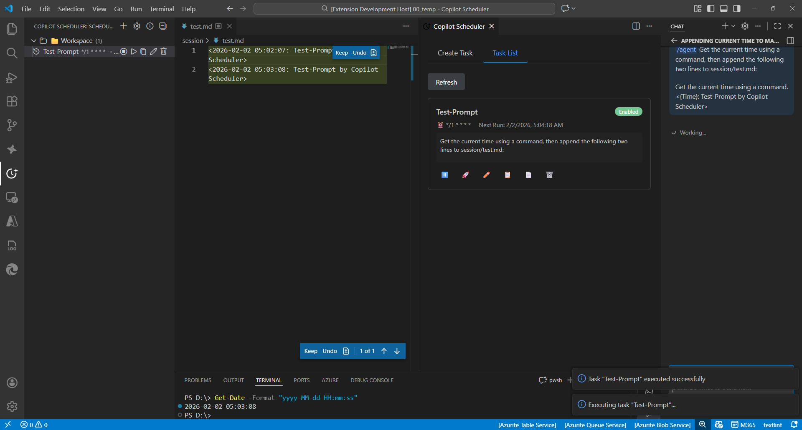

# ⏰ Copilot Scheduler

[](https://github.com/aktsmm/vscode-copilot-scheduler/releases/tag/preview-v1.9.1)
[](https://marketplace.visualstudio.com/items?itemName=yamapan.copilot-scheduler)
[](https://marketplace.visualstudio.com/items?itemName=yamapan.copilot-scheduler)
[](LICENSE)
[](https://github.com/aktsmm/vscode-copilot-scheduler)
[](https://github.com/aktsmm/vscode-copilot-scheduler)

VS Code で AI プロンプトを Cron 式で定期実行、または日時指定で一度だけ実行

[**GitHubから1.9.1 PreviewのVSIXを取得**](https://github.com/aktsmm/vscode-copilot-scheduler/releases/tag/preview-v1.9.1)

## Preview版の配布

このブランチ（`preview/system-api`）はGitHubのPre-releaseとしてのみ配布します。現在のMarketplace安定版は1.8.7です。Preview 1.9.1には安定版への案内リンクと保存済み設定更新の共通修正を含みます。`copilot-scheduler-1.9.1.vsix` を「拡張機能: VSIXからインストール」で導入してください。拡張IDは `yamapan.copilot-scheduler` のままなので、選択したプロファイルの安定版を置き換え、同じタスク保存先を使います。別の検証用プロファイルを推奨します。

モデルの詳細設定を使う場合は、タスク画面の「起動設定を開く」の案内に沿って `enable-proposed-api` にSchedulerを追加し、VS Codeを完全終了して再起動します。Previewの導入だけでは許可は付かず、モデルへのアクセス承認も別途必要です。安定版1.8.7へ戻す場合は `code --install-extension yamapan.copilot-scheduler@1.8.7 --force` を実行してください。Previewで保存した個別設定は自動解除しません。

[English / 英語版はこちら](README.md)

## 🎬 デモ



## ✨ 機能

🗓️ **定期・単発スケジューリング** - Cron 式による定期実行と日時指定による一度きりの実行に対応

🤖 **Agent & モデル選択** - 組み込みAgent (@workspace, @terminal) と AI モデル (GPT-4o, Claude Sonnet 4) を選択可能。利用可能な場合は runtime quality や experimental quality variant も選べます

🌐 **多言語対応** - 英語・日本語 UI を自動検出

📊 **サイドバー TreeView** - 人間が読みやすいスケジュール表示でタスクを管理

🖥️ **Webview GUI** - タスクの作成・編集用の使いやすい GUI

📁 **プロンプトテンプレート** - ローカルまたはグローバルのテンプレートファイルを使用

🛠️ **Copilot Chat ツール** - エージェントモードから Language Model Tools 経由で、スケジュールタスクの確認・作成・更新・削除・有効/無効切替・1回実行ができます

📎 **添付ファイル** - instructions、prompts、skills などワークスペースのファイルをタスクに添付し、プロンプトと一緒に送信できます

## 🚀 クイックスタート

1. Copilot Scheduler サイドバーを開く（アクティビティバーの時計アイコンをクリック）
2. 「+」ボタンをクリックして新規タスクを作成
3. タスク名、プロンプト、Cron スケジュールを入力
4. スケジュールされた時刻に自動で Copilot にプロンプトが送信されます

一度だけ実行したい場合は、フォームの「一度だけ実行する日時」を選び、日時と実行後の処理を指定します。既定では送信後にタスクを無効化し、「タスクを削除（履歴は保持）」を選ぶと履歴保存後に削除します。取りこぼした日時は既存の catch-up / skip 設定に従います。実行済みの無効タスクは、新しい `runAt` を設定するまで再有効化できません。

タスク画面では、Tabキーで選択中のタブへ移動できます。左右キーでタブを切り替え、Home/Endで先頭・末尾のタブを選択し、Tabキーで選択中のパネル内へ移動します。Enter/Spaceは通常のボタン操作として使えます。

## ⏰ Cron 式の例

| 式             | 説明            |
| -------------- | --------------- |
| `0 9 * * 1-5`  | 平日 9:00       |
| `0 18 * * 1-5` | 平日 18:00      |
| `0 9 * * *`    | 毎日 9:00       |
| `0 9 * * 1`    | 毎週月曜日 9:00 |
| `*/30 * * * *` | 30 分ごと       |
| `0 * * * *`    | 1 時間ごと      |

かんたんCronでは、頻度、間隔、時刻、曜日、日付を選ぶと、その内容がすぐにCron式へ反映されます。「生成する」ボタンは明示的に再反映したいときにも使えますが、保存前に押す必要はありません。

かんたんCronの「指定間隔ごと」では、標準Cronで厳密に表現できる間隔だけを候補に表示します。40分ごとや90分ごとのような間隔は、`*/40 * * * *` のような不正確な式ではなく、複数行のCron式として生成されます。生成された各行は同じタスクに属し、スケジューラは複数行のうち最も早い次回時刻で実行します。

毎月のかんたんCronでは、毎月必ず存在する 1〜28 日を既定候補にしています。31日のように「その日がある月だけ」実行したい場合は、カスタムCron式を使ってください。

## 📋 コマンド

| コマンド                                            | 説明                                                                                                   |
| --------------------------------------------------- | ------------------------------------------------------------------------------------------------------ |
| `Copilot Scheduler: Create Scheduled Prompt`        | 新規タスク作成 (CLI)                                                                                   |
| `Copilot Scheduler: Create Scheduled Prompt (GUI)`  | 新規タスク作成 (GUI)                                                                                   |
| `Copilot Scheduler: List Scheduled Tasks`           | すべてのタスクを表示                                                                                   |
| `Copilot Scheduler: Edit Task`                      | タスクを編集                                                                                           |
| `Copilot Scheduler: Delete Task`                    | タスクを削除                                                                                           |
| `Copilot Scheduler: Toggle Task (Enable/Disable)`   | タスクの有効/無効を切り替え                                                                            |
| `Copilot Scheduler: Run Now`                        | タスクを即座に実行                                                                                     |
| `Copilot Scheduler: Copy Prompt to Clipboard`       | プロンプトをクリップボードに                                                                           |
| `Copilot Scheduler: Enable Task`                    | タスクを有効にする                                                                                     |
| `Copilot Scheduler: Disable Task`                   | タスクを無効にする                                                                                     |
| `Copilot Scheduler: Duplicate Task`                 | タスクを複製                                                                                           |
| `Copilot Scheduler: Move Task to Current Workspace` | タスクを現在のWSへ移動                                                                                 |
| `Copilot Scheduler: Open Settings`                  | 設定を開く                                                                                             |
| `Copilot Scheduler: Show Version`                   | バージョン情報を表示                                                                                   |
| `Copilot Scheduler: Show Execution History`         | 実行履歴を表示（記録済みの場合はプロンプト取得元・パス・ハッシュ・解決時刻・フォールバック理由も表示） |
| `Copilot Scheduler: Dump Model Catalog Diagnostics` | モデルカタログ診断を表示                                                                               |

実行履歴には、記録済みの場合、予定時刻・遅延・添付数・プロンプト取得元・パス・ハッシュ・解決時刻・フォールバック理由を表示します。成功エントリは、モデルの応答完了ではなくChatへのプロンプト送信成功を示すため、**送信済み**と表示します。

## 🛠️ Copilot Chat ツール

Copilot Chat のエージェントモードでは、`#` 参照でスケジューラ用ツールを呼び出せます。

| ツール                        | 説明                                                                                                                                  |
| ----------------------------- | ------------------------------------------------------------------------------------------------------------------------------------- |
| `#scheduler_query`            | 読み取り専用の問い合わせ。`kind=list` / `kind=get` / `kind=history` / `kind=preview_cron` / `kind=list_models` / `kind=list_agents`。 |
| `#scheduler_create_task`      | モデル・エージェント・実行制御を含めてスケジュールタスクを作成します。                                                                |
| `#scheduler_update_task`      | `model` / `agent` / `scope` / 実行制御を含めてタスクの項目を更新します。有効/無効の変更は `#scheduler_set_task_enabled` を使います。  |
| `#scheduler_delete_task`      | タスク名・scope・ワークスペースを表示する強い確認後に削除します。                                                                     |
| `#scheduler_set_task_enabled` | タスクを有効化または無効化します。                                                                                                    |
| `#scheduler_run_task`         | タスクを今すぐ実行します。定期タスクの有効/無効は維持し、単発タスクには実行後の処理を適用します。                                     |

単発タスクの手動実行後、ツールは `enabledStateChanged` と `taskDeleted` を返します。実行済みの単発タスクは `oneTimeCompleted` と再設定の案内を返し、再送信しません。

`kind=history` のレスポンスには全件数 `total`、返却件数 `count`、続きの有無 `hasMore`、`statusSemantics`、新しい順の `entries` が含まれます。`status: "success"` はモデルの応答完了ではなくプロンプト送信成功を示します。legacy の不正日時は監査時刻を推測せず保持または省略し、該当時は `executedAtInvalid` / `nextRunAtInvalid` で示します。

単発タスクの作成では `cronExpression` の代わりにタイムゾーンオフセット付き ISO 8601 日時の `runAt`（例: `2030-09-26T21:00:00+09:00`）を指定し、必要なら `afterRun: "disable" | "delete"` を渡します。更新でも同じ項目を使えます。Cron に戻す場合は `runAt: ""` と `cronExpression` を同時に指定します。`kind=list` / `kind=get` に設定が含まれ、`kind=history` は自動削除後もタスク名と `runAt` を保持します。Webview の日時選択はマシンのローカルタイムゾーンです。

`kind=list` は prompt 本文の代わりに短い `promptPreview` と `promptLength` を返します。`local` / `global` のタスクは prompt ファイル全体のスナップショットを保持するためです。write 系ツールの成功レスポンスも同じ形で返します。全文が必要なときは `kind=get` を使い、preview をタスクに書き戻さないでください。

`kind=list_models` は選択可能なモデルの `id` と `supportedReasoningEfforts` を返し、`kind=list_agents` はファイルパスを含めずに選択可能なエージェントを返します。モデル一覧は Copilot Scheduler ビューのモデル選択肢と同一なので、UI で見えない・変更できないモデルを Chat が設定することはありません。作成/更新では `model`（任意で `modelReasoningEffort`）、`agent`、実行制御の `autoMode` / `jitterSeconds` / `maxExecutionsPerDay` / `allowedTimeStart` / `allowedTimeEnd` を指定できます。この一覧にない `model` id は、無言で既定モデルにフォールバックせず有効な id 一覧付きでエラーになります。`model` に空文字を渡すと選択が解除され、既定モデルに戻ります。なお Language Model API が利用できず組込みの fallback カタログしか分からないときは、エラーにせず warning 付きで保存します。

`Auto` および内部 utility モデルの ID は選択肢に残しますが、メタデータ上のモデル名から推論レベルの候補を引き継ぎません。

Codex Bridge、BYOK、Local LLM などの追加 provider が VS Code Chat に登録したモデルも、Copilot モデルと同じ一覧から選択できます。モデル選択欄は提供元ごとに分かれ、品質バリエーションは別の選択欄に表示します。`kind=list_models` が返す `vendor` を作成・更新時の `modelVendor` に指定すると、提供元間で重複するモデル ID を区別できます。完全一致 ID を正規化した別名より優先し、ID・別名・モデル名の照合で提供元が曖昧な場合は `modelVendor` を要求します。保存した提供元をモデル解決時にも維持します。Copilot 専用カタログの照会が失敗しても他の提供元の検出を続け、全体カタログの照会が失敗しても取得済みの Copilot モデルは保持します。

追加 provider を明示選択した場合、モデル不在や Chat への送信失敗時には停止し、既定モデルや別の提供元に切り替えて再試行しません。提供元の認証・接続と、選択した Chat / Agent モードへの対応は必要です。送信成功は提供元の応答完了を保証しません。独立した Claude / Codex のエージェント実行環境のスケジュールは対象外です。

Codex Bridge 1.0.0 の GPT 6 Luna（`openai-codex`、`<profile>::gpt-6-luna`）には、タスク別の `Default` / `Low` / `High` を試験的に追加しています。公開 API では実際の対応レベルを取得できないため、このモデルの限定的な互換ルールであり、他モデルには思考候補を追加しません。移行しない旧方式の明示設定は Chat と共有の per-model 設定へ反映し、速度・コンテキスト設定と他 profile は維持します。`Default` はタスクの思考指定を解除して現在の共有設定を継承し、共有値を削除・リセットしません。対象 profile が欠落・重複、未知の設定形式、設定書き込み失敗の場合は送信を停止します。他モデル・他 provider のオプションは提供元の設定画面で指定してください。2026-10-09 に隔離環境の VS Code 1.141.0 と候補版で、Ask モード・通常速度の Low / High の実応答と Bridge の適用ログを確認しました。Default / Fast の実推論、他モデル・他環境は未確認です。

#### 動的モデル設定（試験的）

タスクフォームと `scheduler_query kind=list_models` は、VS Code 内部の `vscode://schemas/language-models` からモデル別の enum 候補値・表示名を取得します。対象は `mode` / `reasoningEffort` / `speedMode` / `contextSize` です。数値は数値のまま保存し、Fast・コンテキスト候補は選択モデルが公開する場合だけ表示します。未対応・取得不可のスキーマから候補を推測せず、保存済みの候補が消えても表示を残します。内部スキーマ形式は VS Code の更新で変わる可能性があります。

ホストAPI（VS Code 1.141 以降）・実効的なSystem API利用許可・モデルの広告項目が揃う環境だけで、詳細設定をチェックボックスなしで直接表示します。未指定の項目は現在の共有 Chat 設定を継承します。許可がない環境では詳細入力を有効にせず、保存済み値を読み取り専用で残します。従来の思考負荷は別の共有設定経路を使うためSystem許可を必要としません。継承への変更は明示操作だけで行います。思考負荷のプレビュー案内は旧方式の候補が使える場合だけ表示します。

VS Code 1.141 以降では、モデル一覧に基づく修復・保存・実行時に、スキーマで同等性を確認できる旧設定を移行します。旧 effort 未指定は共有設定の継承へ変換します。明示した effort は実効System API許可がある場合だけ同じ広告 `reasoningEffort` 値へ移行し、許可がなければ利用できないnative上書きに変えず旧指定を保持します。既存の明示 map は変更しません。effort だけから複合 `mode` 値を推測せず、対応値がない旧設定や古いホストは旧方式を維持します。起動時の修復で移行できた値は、通常のタスク保存経路で永続化します。

新規タスクの `modelConfiguration: {}` は、共有 Chat 設定を変更せず継承します。更新で map を省略すると既存値を維持し、`{}` はタスクの上書きだけを解除します。ユーザーや旧方式が共有設定に残した値は削除しません。**詳細設定には VS Code 1.141 以降が必要ですが、それだけでは利用できません。** Agent のシステム指示には、Scheduler に対する実効的な `languageModelSystem` API 利用許可が必要です。GUIは動的実行APIと実効許可が揃う場合だけ詳細編集を有効にします。保存済みの個別値は表示を残し、自動解除しません。実効的なSystem許可がなければ通常 Chat / Agent の個別指定は送信前に停止します。モデル指定と現在値の継承は利用できます。

ローカル開発版のmanifestには、許可付き検証用の `languageModelSystem` 宣言を追加しています。宣言だけでは許可は付きません。この提案API利用版はローカル検証用で、Marketplace公開用ではありません。インストールやVS Code更新だけでは有効化されず、実行環境から `yamapan.copilot-scheduler` への明示的な利用許可が必要です。

詳細項目を持つモデルでは、タスク設定画面に不足する条件を表示します。対応ホストで宣言済み・未有効化の場合の「起動設定を開く」は、VS Code のランタイム引数編集画面を開くだけで、設定を自動変更しません。既存の `enable-proposed-api` 配列に `yamapan.copilot-scheduler` を追加し、項目がなければ `"enable-proposed-api": ["yamapan.copilot-scheduler"]` を追加します。他の項目は維持し、VS Code を完全終了して再起動してください。宣言なしの配布版・非対応ホストには、それぞれの制限理由を表示し、有効化ボタンは出しません。保存済みのタスク設定は保持します。

System ロールの提案元は、Johannes Rieken（`jrieken`）氏の [Language model access API Issue #206265](https://github.com/microsoft/vscode/issues/206265) です。[PR #212082](https://github.com/microsoft/vscode/pull/212082) で2024年5月6日に独立した提案へ分離され、理由は API 設計と Responsible AI の検討とされています。モデルへのアクセス承認は別の仕組みです。

選択モデルの設定スキーマが未取得・不正なら、API 有効化後も理由を表示します。ただし設定項目は推測で追加しません。有効化の手順は未有効化の場合だけ案内します。取得済みスキーマで設定項目がないと確認できたモデルには、不要な設定ボタンを出しません。API の有効化だけで、そのモデルの詳細設定に対応するとは限りません。

Marketplace公開前は `node scripts/verify-vsix-contents.js <candidate.vsix> --verify-marketplace` を実行します。公開ワークフローは実際の配布物のmanifestを検査し、提案API宣言があれば公開前に停止します。ローカル検証用候補の `--verify-build` は引き続き利用できますが、それだけでMarketplace公開可能とは判定しません。

API の利用許可と、提供元モデルへのアクセス承認は別です。初回の「Scheduler が GitHub Copilot などのモデルへアクセスしてよいか」というダイアログは、要求したアクセスを承認する必要があります。この承認だけで提案 API の利用許可が付くわけではありません。拡張自身が VS Code の許可を付与することはできず、対応したビルドと正規の実行環境の許可が必要です。拡張に必要な API 宣言がない場合、起動オプションだけでは有効化できません。提案 API には[配布上の制限](https://code.visualstudio.com/api/advanced-topics/using-proposed-api)もあります。

VS Code や提供元の仕様変更により、以前動いた環境でも詳細設定が使えなくなる場合があります。その場合、モデル指定と現在の共有設定の継承だけが利用可能になることがあります。保存済みの明示設定は保持して理由付きで停止し、黙って継承・解除したり別モデルで実行したりしません。対応する設定は共有値を書き換えずリクエストごとに固定します。

対応する Chat 経路では、User / Assistant、ツール呼び出し・結果、応答ストリーム、キャンセルを中継します。System は実効API許可がある場合だけそのまま転送し、未対応ロールは元モデルの検索・送信・token count の前に拒否します。システム指示を削除・User化しません。実行時の許可は、任意の提供元・パラメーター・ネイティブエージェント基盤の動作保証ではありません。モデル不在、候補変更・不正値、アクセス承認失敗、送信失敗では停止し、別モデルへの代替や自動再送は行いません。旧設定から空でない動的 map へ移行した場合も同じ制限を適用します。

map は通常編集・複製・再読み込みで維持し、モデル変更時は動的な上書きを解除します。旧 Scheduler で保存すると項目を失う可能性があるため、ダウングレードして保存しないでください。選択したキーはリクエストごとに固定し、未指定キーは元モデルの設定を継承します。スキーマ URI と設定転送は VS Code の内部互換契約です。古いホストは明示設定の実行を拒否し、旧方式と継承を維持します。内部の固定モデルはタスク候補に表示しません。隔離した VS Code 1.141.1 の権限なし中継で System ロールが元モデル呼び出し前に拒否されることと、User / Assistant / tool の設定固定転送・共有設定不変を確認しました。候補取得・保存・送信・実応答・提供元での実効設定確認は別の検証結果です。合成試験は実提供元の推論や設定適用を保証しません。

#### 追加 Provider の検証手順

明示したモデルとタスク設定は厳守します。未指定の項目だけ共有設定を継承し、適用できない明示設定は説明付きで停止して保存値を保持します。自動的に継承へ切り替えません。明示モデルは選択した識別情報で1回だけ送信し、失敗時に旧思考設定を落とす、モデル指定なしで再試行する、旧テキストコマンドへ代替する処理は行いません。

検索条件だけでなく、実際に返ったモデルの識別情報も照合します。提供元・モデル ID・明示固定した version が違う場合、元モデルへの送信や token count の前に停止します。version 未固定の元モデルは候補を再検証して使用し、内部の設定固定モデルは自身の宣言した識別情報と一致することを確認します。リクエスト設定の準備では呼び出し元の設定やツール配列を変更しません。

キャンセルと provider の破棄は、元モデル・スキーマの準備待ち、送信、stream待ち、token count を停止します。破棄後に準備が戻っても新しい送信や進捗は出しません。callerのキャンセルは速やかに終了し、別callerの共有token準備は維持します。モデル解決中に登録providerが入れ替わった場合も、別世代へ結び直さず拒否します。固定リクエスト設定は保持し、キャンセル・失敗後に別設定で再試行しません。

同じモデル ID・提供元を再指定しただけの場合、タスクの動的設定は維持します。どちらかが実際に変わる場合は、新しい設定を明示指定して検証した場合を除き、前の上書きを解除します。`model` の空文字指定は ID・名前・提供元・family・version・設定 map をすべて解除し、旧表示名から選択が再解決されることを防ぎます。

不正な保存設定は、フォームで空の上書きへ変換せず原型のまま保持します。該当する選択欄を無効にし、**共有モデル設定を継承する**操作を明示的に選んだ場合だけ修復します。モデル一覧の更新に失敗した場合は、モデル識別情報を残して古い動的候補を無効化します。スキーマで秘密またはパスワードと明示された項目はタスク候補へ公開しません。

モデル一覧が空になった場合や保存済みモデルが見つからない場合も、保存した上書きを消さずに古い編集候補とプレビュー案内を除去します。モデルが復旧すると公開候補と保存済みの型付き値を復元します。旧バリアントの変更は、選んだ effort を解決してから表示し、黙って継承へ戻しません。選択欄を作り直すか非表示にする前に、キーボードフォーカスをモデル選択欄へ戻します。任意の検証コマンド `python -B scripts/verify-model-options-browser.py` には Playwright を導入した Python 環境と Microsoft Edge が必要です。本番関数と合成カタログをデスクトップ・狭い画面の実 DOM で確認するもので、完全な VS Code ホストやスクリーンリーダーの検証ではありません。

検出・選択・送信の自動テストは合成 provider を使うため、認証、実際の推論、ホスト UI の動作を保証しません。保存済みタスクを取り込まず、保存先を分離した空の VS Code プロファイルで確認します。

1. 確認用 Scheduler パッケージと provider をインストールし、認証は provider の UI で直接行います。モデル選択欄と `scheduler_query` の `kind=list_models` の `id`・`vendor` を照合します。
2. 該当 `model`・`modelVendor` を指定した、確認専用の**無効な workspace タスク**を1件作成します。添付は使わず、プロンプトは `Reply exactly PROVIDER_SMOKE_OK` など無害なものにします。再取得して提供元が一致することを確認します。
3. そのタスクだけを1回手動実行します。Chat の選択 provider と実際の応答を、Tool の送信結果とは別に確認します。タスクは無効のままである必要があります。
4. 隔離プロファイル内で該当 provider を利用不可にし、同じタスクを実行します。Copilot や他の提供元へ切り替わらず送信が停止することを確認します。provider を復旧し、カタログ更新後も保存した選択が保持されることを確認します。
5. 確認専用タスクと、自分が作成した隔離プロファイル・保存先だけを削除します。実タスクでの試験や認証情報のエクスポートは行いません。

作成/更新では `attachments` も指定できます。`{ source: "local" | "global", path }` を最大 10 件まで渡せ、パスはタスクのワークスペースフォルダー基準またはグローバルプロンプトフォルダー基準の相対パスです。絶対パス、`..`、NUL文字、添付禁止ファイル、Global タスクへの `local` 添付は保存されずエラーになります。

エージェントモードでは、Copilot が自然文の依頼からこれらのツールを選ぶこともできます。例:

- 「このリポジトリの要約を毎週平日 9:00 に作るワークスペースタスクをスケジュール設定して」
- 「日次サマリータスクを 10:30 実行に変更して」
- 「日次サマリータスクのモデルを Claude Sonnet にして」
- 「リリースリマインダーのタスクを再開するまで一時停止して」
- 「無効のリリースリマインダーを有効化せず、今すぐ1回だけ実行して」
- 「変更する前に、登録済みの Copilot スケジュールタスクを見せて」

同じ名前のタスクが scope をまたいで複数あり得る場合は、更新・無効化・削除の前に登録済みタスクを表示するよう Copilot に依頼すると、対象タスクを確認してから進められます。

`scheduler_run_task` の入力は `{ "id": "..." }` だけで、プロンプト・添付の解決と履歴記録は既存の「今すぐ実行」と共通です。無効タスクは無効のまま、有効タスクの `nextRun` は `manualRunNextRunPolicy` に従って進みます。手動実行なので jitter・実行可能時間帯・日次上限は適用しません。workspace タスクは現在のワークスペースに属する必要があります。

`ok: true` と `executionSemantics: "prompt_dispatched"` は送信成功を示し、モデル応答完了ではありません。`saveFailed` でも送信自体は済んでおり、`prompt_dispatched` と `retrySafe: false` を返すので自動再試行しないでください。予期しない例外は `executionSemantics: "unknown"` と `retrySafe: false` を返すため、先に Chat と履歴を確認してください。キャンセル確認は実行開始前だけで、開始後の処理中断や送信取消はできません。呼び出しごとに新しい手動要求として扱い、同じウィンドウで送信・履歴記録中の重複要求は拒否します。処理終了後の再呼び出しは再実行になるため、冪等な操作ではありません。

write 系ツールは既定で有効ですが、信頼済みワークスペースが必要です。`copilotScheduler.lmTools.enableWriteTools` を `false` にすると、作成・更新・削除・有効/無効切替・1回実行の呼び出しを拒否します。ツール自体は表示されたまま、読み取り系だけが利用できます。

`copilotScheduler.lmTools.confirmationMode` が制御するのは、この拡張が write 系ツールで返すカスタム確認メッセージだけです。VS Code または Copilot Chat 側の汎用承認ダイアログは引き続き表示される場合があり、利用可能な場合は VS Code 側の Always Allow フローを使えます。

タスクスナップショットと revision metadata は同一ディレクトリの一時ファイルへ書き込み、atomic replace で更新します。空/破損ファイルと metadata のない revision 0 の `[]` は有効な legacy globalState を上書きせず、revision 付きの空配列は正当な全削除として維持します。foreground save と mirror は保存先ごとに同じ queue を使います。MIT ライセンスの `proper-lockfile` による atomic directory lock、heartbeat/stale recovery、revision 再確認により、古い VS Code ウィンドウが新しいタスクを上書きするのを防ぎ、競合時は最新snapshotを再読み込みして再試行を案内します。payload/mirrorの完了後にだけmetadataを進め、lockを解放します。

## ⚙️ 設定

| 設定                                          | デフォルト        | 説明                                                                                                                                                                                                                                                                     |
| --------------------------------------------- | ----------------- | ------------------------------------------------------------------------------------------------------------------------------------------------------------------------------------------------------------------------------------------------------------------------ |
| `copilotScheduler.enabled`                    | `true`            | スケジュール実行の有効/無効                                                                                                                                                                                                                                              |
| `copilotScheduler.defaultScope`               | `workspace`       | デフォルトスコープ                                                                                                                                                                                                                                                       |
| `copilotScheduler.language`                   | `auto`            | UI 言語 (auto/en/ja)。拡張の Webview/Tree に適用。設定説明文の反映にはウィンドウ再読み込みが必要な場合があります。                                                                                                                                                       |
| `copilotScheduler.timezone`                   | `""`              | スケジュール、実行可能時間帯、1 日の実行回数カウントに使うタイムゾーン                                                                                                                                                                                                   |
| `copilotScheduler.jitterSeconds`              | `600`             | タスク実行前に入れるランダム遅延の最大秒数 (0〜1800、0=無効、タスクごとに上書き可)                                                                                                                                                                                       |
| `copilotScheduler.manualRunNextRunPolicy`     | `fromNow`         | `Run Now` 後の次回実行計算: `fromNow`（現在時刻より後の次のcron予定）/ `advance`（既存の未来の次回予定を消化し、なければ現在時刻から再計算）。明示的な選択は維持します。                                                                                                 |
| `copilotScheduler.missedRunPolicy`            | `runOnce`         | スケジューラ起動前に期限を迎えたタスク: `runOnce` は各タスクを1回実行、`skip` は実行せず次回へ進めます。VS Code の設定画面で選択できます。                                                                                                                               |
| `copilotScheduler.maxConcurrentAutomaticRuns` | `1`               | このウィンドウの自動プロンプト送信処理の最大同時数（jitterを含む、1〜10）。モデル応答の完了は待ちません。「今すぐ実行」は対象外です。                                                                                                                                    |
| `copilotScheduler.chatSession`                | `new`             | チャットセッションの既定動作 (new/continue)。Webview フォームでタスクごとに上書きできます。`continue` は通常より高速です。                                                                                                                                               |
| `copilotScheduler.autoModeDefault`            | `false`           | 新規タスク作成時のオートモードヒント既定値（有効時、実行時プロンプトの先頭に自律実行の指示を自動挿入）                                                                                                                                                                   |
| `copilotScheduler.commandDelayFactor`         | `0.8`             | Copilotコマンド実行時の待機時間倍率 (0.1〜2.0)。小さいほど高速ですが、環境によっては安定性が低下する場合があります。                                                                                                                                                     |
| `copilotScheduler.showNotifications`          | `true`            | タスク実行時に通知を表示                                                                                                                                                                                                                                                 |
| `copilotScheduler.notificationMode`           | `sound`           | 通知モード (sound/silentToast/silentStatus)                                                                                                                                                                                                                              |
| `copilotScheduler.maxDailyExecutions`         | `24`              | 1日のスケジュール実行回数上限（全タスク合計、0=無制限、1〜100）。⚠️ 無制限はAPIレート制限のリスクあり                                                                                                                                                                    |
| `copilotScheduler.minimumIntervalWarning`     | `true`            | 30分未満のcron間隔を設定するときに警告表示                                                                                                                                                                                                                               |
| `copilotScheduler.globalPromptsPath`          | `""`              | グローバルプロンプトフォルダーのパス（未指定時: VS Code の User/prompts フォルダー。Windows: `%APPDATA%/Code/User/prompts`、macOS: `~/Library/Application Support/Code/User/prompts`、Linux: `$XDG_CONFIG_HOME/Code/User/prompts` または `~/.config/Code/User/prompts`） |
| `copilotScheduler.globalAgentsPath`           | `""`              | グローバルエージェントフォルダー（`*.agent.md`）のパス（未指定時: VS Code の User/prompts フォルダーと `~/.copilot/agents` を自動検出。設定すると既定の探索先より優先）                                                                                                  |
| `copilotScheduler.promptFileFallback`         | `"snapshot"`      | ローカル / グローバルのプロンプトファイルを実行時に読めなかった場合の動作: `snapshot`（保存済みスナップショットで実行）/ `blockWhenResolvable`（パスは解決できるのに読めない場合は中止）/ `blockAlways`（常に中止）。インラインプロンプトは対象外                        |
| `copilotScheduler.logLevel`                   | `info`            | ログレベル (none/error/info/debug)                                                                                                                                                                                                                                       |
| `copilotScheduler.executionHistoryLimit`      | `50`              | 実行履歴ビューにタスクごとに保持する件数上限（10〜500）                                                                                                                                                                                                                  |
| `copilotScheduler.lmTools.enableWriteTools`   | `true`            | Copilot Chat ツールから作成・更新・削除・有効/無効切替・1回実行を許可します。`false` でも変更系ツールは表示されますが呼び出しを拒否します。                                                                                                                              |
| `copilotScheduler.lmTools.confirmationMode`   | `destructiveOnly` | write 系ツールで拡張側のカスタム確認メッセージを出す範囲を制御します: `always` / `destructiveOnly` / `minimal`。VS Code/Copilot 側の汎用承認は表示される場合があります。                                                                                                 |

AI が適用した編集を遅延後に自動で保持するには、VS Code 設定 `chat.editing.autoAcceptDelay` を設定してください（`0` = 無効、`1-100` = 秒、推奨: `5`）。

未実行判定はスケジューラの起動・再開時刻より前の `nextRun` だけが対象です。`skip` は実行履歴・日次件数を増やさず次回へ進め、後から設定を戻しても破棄した予定は復元しません。起動後のスリープによる遅延は起動前の未実行とは区別します。設定変更は次回チェックから反映し、処理中の送信は中断しません。待機タスクは後続 tick で古い予定から選び、許可時間帯と日次上限も適用します。処理中の送信が予約した日次枠は、成功・失敗が確定するまで他のタスクに割り当てません。同時数の既定値は従来の無制限から1に変わりますが、モデル応答は並行する可能性があり、別の VS Code ウィンドウの送信上限とは独立しています。

タスク単位の運用制御（「チャットセッション」「上限/日」「実行許可時間帯」）は Webview の作成/編集フォームで設定できます。「上限/日」と「実行許可時間帯」はスケジュールと同じ時計で判定します。`copilotScheduler.timezone` を設定していればそのタイムゾーン、未設定ならマシンのローカル時刻です。

Webview では、対応 family に対して Copilot Chat に近い思考の負荷候補をプレビュー表示します。失敗するときは「既定」を選んでください。

> Claude Opus / Sonnet は adaptive thinking 型モデルです。本拡張は選択した思考の負荷を Copilot 自身と同じ per-model 設定へ書き込みますが、Claude の実効的な思考量は Copilot Chat 側の adaptive thinking が制御するため、`Medium` のまま適用されることがあります。GPT-5 系モデルは選択した思考の負荷をそのまま反映します。

実行トリガー時に重く感じる場合は、次を先に試してください:

- `copilotScheduler.chatSession = continue`
- `copilotScheduler.commandDelayFactor = 0.6`（または `0.5`）
- `copilotScheduler.notificationMode = silentStatus`
- `copilotScheduler.logLevel = error`（または `none`）

## 📝 プロンプトプレースホルダー

プロンプトで使用できるプレースホルダー:

| プレースホルダー | 説明             |
| ---------------- | ---------------- |
| `{{date}}`       | 現在の日付       |
| `{{time}}`       | 現在の時刻       |
| `{{datetime}}`   | 現在の日時       |
| `{{workspace}}`  | ワークスペース名 |
| `{{file}}`       | 現在のファイル名 |
| `{{filepath}}`   | ファイルパス     |

## 📂 タスクスコープ

- **グローバル**: すべてのワークスペースでタスクを実行
- **ワークスペース**: 作成したワークスペースでのみ実行

## 📄 プロンプトテンプレート

再利用可能なプロンプトテンプレート:

- **ローカル**: ワークスペース内の `.github/prompts/*.md`
- **グローバル**: VS Code ユーザープロンプトフォルダ（または `copilotScheduler.globalPromptsPath` で指定したフォルダ）
- 編集フォームは `ローカル/グローバル` 選択中は参照先と **プロンプトファイルを開く** を表示し、本文欄は非表示にします。本文を直したいときはこの操作でソースを編集してください。タスク側の本文を表示して編集する場合は **インライン** に切り替えます。モデルなど他の設定を変更してもファイル参照は維持されます。
- パネルのプレビューはディスクへ保存済みの内容だけを読みます。実行時は開いているエディターの内容を優先し、なければ最新の保存済みファイルを読み込みます。
- **インライン** になるのは、プロンプト種別で明示的にインラインを選んだときだけです。テンプレートを選んでいる間はファイル参照のまま維持されます。
- タスクの作成・更新、テンプレート読み込み、プロンプトのパス解決では、NUL文字を含むパスを拒否します。キャッシュに存在する場合や、文字列上は許可ルート内に見える場合も同様です。

`copilotScheduler.globalAgentsPath` が空の場合、グローバル custom agent は VS Code の user prompts/customization フォルダーと `~/.copilot/agents` から自動検出されます。

これは最近の Copilot custom agent / Copilot CLI のファイル配置に合わせた検出で、拡張機能が行うのは agent ファイルの発見だけです。プロンプトテンプレートは引き続き VS Code ユーザープロンプトフォルダまたは `copilotScheduler.globalPromptsPath` を使い、`~/.copilot/prompts` は既定探索しません。また、Copilot CLI セッション自体をこの拡張が管理するわけではありません。

## 📎 添付ファイル

1 つのタスクに最大 10 件のファイルを添付できます。添付したファイルはプロンプトと一緒に送信されるので、instructions や skills をプロンプト本文で言及する代わりに、明示的に添付できます。

- **添付を追加** を押すと、**おすすめ**（`AGENTS.md`、`.github/copilot-instructions.md`、`.github/prompts/`、`.github/instructions/`、`.github/skills/`）とワークスペース内のファイルを含むクイックピックが開きます。**参照...** は通常のファイルダイアログを開きます。
- パスはワークスペースフォルダー基準（`local`）またはグローバルプロンプトフォルダー基準（`global`）の相対パスで保存され、絶対パスは保存しません。
- **ワークスペースのファイルを添付できるのは、スコープが Workspace のタスクだけです。** Global タスクはどのウィンドウでも実行され、同じ相対パスが別のファイルを指す恐れがあるため拒否します。
- `.env*`、`*.pem`、`*.key`、`id_rsa*` や `secrets/`、`.ssh/` 配下のファイルは添付できません。
- **実行時に添付ファイルが見つからない場合、添付なしで実行せずにタスクをスキップします。** 実行履歴に `blocked` として記録され、同じ添付内容につき 1 回だけ通知されるので、リネームに気付かずにスケジュールが止まり続けることを防ぎつつ、添付を変更した後に再び失敗した場合は改めて通知します。
- **信頼境界**: 上記の検査はパスの境界であって、ファイルの出所を保証するものではありません。ワークスペースフォルダーに書き込めるものは、そこにファイルを置いたりリンクしたりできます。またファイルは実行時に読まれるため、送信されるのはその時点の内容です。無人実行されるプロンプトファイルと同じだけ信頼できるワークスペースでのみ添付を使ってください。

## 📋 要件

- 既存のスケジュール・旧形式実行は VS Code 1.95.0 以上。タスク別の動的モデル設定は VS Code 1.141.0 以上と元モデルへのアクセス承認が必要です。古いホストでは旧方式・継承を維持し、明示した動的設定の実行は拒否します。
- GitHub Copilot 拡張機能

## 開発時のテスト

`npm test` はコンパイル後、隔離された VS Code プロファイルで全テストを実行します。Copilotへのサインインは不要です。スイート名とテスト名を含むタイトルで絞り込むには、JavaScriptの正規表現を `--grep`（または `-g`）で指定します。Windows PowerShellでは、オプションを正しく渡すため `npm.cmd` を使ってください。

```powershell
npm.cmd test -- --grep "Test Runner Arguments"
```

`|` による選択など、シェルが解釈する文字を含む場合は、先にコンパイルしてNodeを直接実行します。

```powershell
npm.cmd run pretest
node ./out/test/runTest.js --grep 'tabs|claim'
```

正規表現は空白も含めてそのまま使います。未知の引数、空・不正なパターン、一致0件は失敗になります。引数なしなら、フィルター環境変数を継承していても全テストを実行します。部分テストの成功だけでリリースせず、公開前は `npm test` を実行してください。

### インストール済みVSIXのスモーク検証

開発モードを使わず、配布物の内容・ビルド一致と、インストール済み拡張の許可なしツール契約を確認できます。

```powershell
node scripts/verify-vsix-contents.js artifacts/vsix/copilot-scheduler-allfix-lifecycle-candidate.vsix --verify-build --verify-installed --vscode-executable .vscode-test/vscode-win32-x64-archive-1.141.1/Code.exe
```

既存の互換VS Code実行ファイルを指定します。検証は選択したVSIXとローカル補助VSIXを新しい一時プロファイルへインストールし、archive自身の識別情報・版を使って読み取り専用の `scheduler_query list_models` だけを呼び出します。補助からモデル推論やタスク操作は行いません。開発・テスト・提案APIの起動フラグなしでProductionモードと対象のインストール位置、実行時のSystem許可なしを確認し、所有する窓とプロセスの終了後に一時環境を削除します。起動に影響する継承環境は除去し、空白を含むパスにも対応します。終了未確認なら所有rootを明示cleanup用に残し、通常・共有VS Codeプロセスを停止しません。これは許可なしのインストール契約の検証であり、提供元サインイン、全UI・AT、許可付きnative実行やMarketplace公開の証明ではありません。

## 🛠️ リリース自動化

メンテナーはローカルで `vsce publish` を実行しなくても、GitHub Actions から公開できます。

- `package.json` の version を更新した後、同じ番号の `vX.Y.Z` タグを push します。
- GitHub Actions が `npm ci`、`npm run compile`、`npm test`、`.vsix` 作成、VS Code Marketplace 公開、GitHub Release への `.vsix` 添付まで実行します。
- 公開前の確認は、対象ブランチで `Publish Extension` を `publish=false`（既定値）として手動起動します。全ゲート成功後にバージョンタグをpushします。ブランチ・タグをまたいでジョブは直列化されます。明示的な `publish=true` はMarketplaceのみへ公開し、GitHub Releaseには対応するタグが必要です。
- 利用前に repository secret `VSCE_PAT` を設定してください。

## ⚠️ 既知の問題

- Copilot Chat API は開発中のため、API の安定化に伴い更新が必要になる場合があります
- 一部の構成ではモデル選択が機能しない場合があります
- Experimental model quality は VS Code/Copilot 内部実装への依存があり、環境によっては動かない場合があります

**免責:** この拡張機能は Copilot Chat を自動操作します。GitHub の [Acceptable Use Policies](https://docs.github.com/en/site-policy/acceptable-use-policies/github-acceptable-use-policies#4-spam-and-inauthentic-activity-on-github) は「過度な自動化された一括活動」を、[利用規約 セクション H (API Terms)](https://docs.github.com/en/site-policy/github-terms/github-terms-of-service#h-api-terms) は API の過剰利用によるアカウント停止を明記しています。また [GitHub Copilot の追加製品規約](https://docs.github.com/en/site-policy/github-terms/github-terms-for-additional-products-and-features#github-copilot) により、これらの規約は Copilot にも直接適用されます。リスクを理解した上でご利用ください。ジッターや1日上限、長めの間隔はリスク低減になりますが、アカウント制限を防ぐ保証はありません。

※ 自動化ツールを使っていなくても Copilot アクセスが制限された[事例](https://github.com/orgs/community/discussions/160013)があります。本拡張の緩和策はリスクを下げるだけで、リスクをゼロにはできません。

🐛 [バグを報告](https://github.com/aktsmm/vscode-copilot-scheduler/issues)

## 📄 ライセンス

[CC-BY-NC-SA-4.0](LICENSE) © [aktsmm](https://github.com/aktsmm)

---

**Copilot プロンプトのスケジュール実行をお楽しみください！** 🚀
